# Dokumentasi Database: `proyekGMN`

**Tanggal Digenerate:** 2026-11-11 09:57:20

---

## Diagram Relasi (ERD)

```mermaid
erDiagram
    m_employee ||--o{ employee_status : "employee_id -> id"
    m_currency ||--o{ po_items : "currency_id -> id"
    projects ||--o{ supplier_return_hdr : "project_id -> id"
    material_out_header ||--o{ material_out_items : "material_out_id -> id"
    warehouses ||--o{ supplier_return_hdr : "warehouse_id -> id"
    m_suppliers ||--o{ supplier_return_hdr : "supplier_id -> id"
    purchase_orders ||--o{ supplier_return_hdr : "po_id -> id"
    material_out_header ||--o{ supplier_return_hdr : "material_out_id -> id"
    supplier_return_hdr ||--o{ supplier_return_dtl : "return_hdr_id -> id"
    materials ||--o{ supplier_return_dtl : "material_id -> id"
    warehouses ||--o{ material_leftover_header : "warehouse_id -> id"
    project_tasks ||--o{ project_invoices : "task_id -> id"
    m_form_group ||--o{ m_form_name : "group_id -> id"
    m_form_name ||--o{ m_user_access_menu : "form_id -> id"
    m_user_system ||--o{ m_user_access_menu : "user_id -> id"
    m_employee ||--o{ m_user_system : "employee_id -> id"
    m_user_system ||--o{ m_user_login_status : "user_id -> id"
    m_form_name ||--o{ m_form_links : "form_id -> id"
    m_form_name ||--o{ m_form_links : "link_form_id -> id"
    m_currency ||--o{ po_items : "currency_id -> id"
    clients ||--o{ projects : "client_id -> id"
    projects ||--o{ budget_items : "project_id -> id"
    materials ||--o{ budget_items : "material_id -> id"
    material_receipt_header ||--o{ material_receipt_items : "receipt_id -> id"
    materials ||--o{ material_receipt_items : "material_id -> id"
    bin_locations ||--o{ material_receipt_items : "bin_location_id -> id"
    projects ||--o{ purchase_orders : "project_id -> id"
    purchase_orders ||--o{ po_items : "po_id -> id"
    budget_items ||--o{ po_items : "budget_item_id -> id"
    materials ||--o{ po_items : "material_id -> id"
    projects ||--o{ warehouses : "project_id -> id"
    warehouses ||--o{ bin_locations : "warehouse_id -> id"
    projects ||--o{ material_receipt_header : "project_id -> id"
    purchase_orders ||--o{ material_receipt_header : "po_id -> id"
    pics ||--o{ material_receipt_header : "received_by -> id"
    pics ||--o{ material_receipt_header : "reversed_by -> id"
    coa_accounts ||--o{ coa_accounts : "parent_id -> id"
    chart_of_accounts ||--o{ supplier_payments : "account_id -> id"
    m_currency ||--o{ purchase_orders : "budget_currency_id -> id"
    coa_accounts ||--o{ journal_entry_lines : "account_id -> id"
    projects ||--o{ journal_entry_lines : "project_id -> id"
    projects ||--o{ material_out_header : "project_id -> id"
    materials ||--o{ material_out_items : "material_id -> id"
    warehouses ||--o{ material_out_header : "warehouse_id -> id"
    warehouses ||--o{ material_receipt_header : "warehouse_id -> id"
    projects ||--o{ financial_expenses : "project_id -> id"
    m_suppliers ||--o{ financial_expenses : "supplier_id -> id"
    m_location ||--o{ warehouses : "location_id -> id"
    m_location ||--o{ projects : "location_id -> id"
    m_employee ||--o{ projects : "pic_id -> id"
    chart_of_accounts ||--o{ financial_expenses : "account_id -> id"
    m_currency ||--o{ grn_hdr : "currency_id -> id"
    chart_of_accounts ||--o{ chart_of_accounts : "parent_id -> id"
    chart_of_accounts ||--o{ general_ledger : "account_id -> id"
    chart_of_accounts ||--o{ fiscal_config : "credit_account_id -> id"
    chart_of_accounts ||--o{ fiscal_config : "debit_account_id -> id"
    journal_lines ||--o{ general_ledger : "journal_line_id -> id"
    accounting_periods ||--o{ journal_entries : "period_id -> id"
    m_user_system ||--o{ journal_entries : "posted_by -> id"
    chart_of_accounts ||--o{ journal_lines : "account_id -> id"
    journal_entries ||--o{ journal_lines : "journal_id -> id"
    m_contact_person ||--o{ m_address : "contact_person_id -> id"
    m_customer ||--o{ customer_npwp : "customer_id -> id"
    customer_npwp ||--o{ m_address : "npwp_id -> id"
    m_agent ||--o{ m_address : "agent_id -> id"
    m_country ||--o{ m_address : "country_id -> id"
    m_village ||--o{ m_address : "village_id -> id"
    m_agent ||--o{ m_contact_person : "agent_id -> id"
    projects ||--o{ financial_incomes : "project_id -> id"
    m_region ||--o{ m_country : "region_id -> id"
    m_district ||--o{ m_village : "district_id -> id"
    m_city ||--o{ m_district : "city_id -> id"
    m_agent ||--o{ m_contact_no : "agent_id -> id"
    m_contact_person ||--o{ m_contact_no : "contact_person_id -> id"
    m_customer ||--o{ financial_incomes : "customer_id -> id"
    chart_of_accounts ||--o{ financial_incomes : "account_id -> id"
    m_currency ||--o{ wh_receiving_dtl : "currency_id -> id"
    wh_receiving_hdr ||--o{ supplier_return_hdr : "wh_receiving_hdr_id -> id"
    material_leftover_header ||--o{ material_leftover_items : "header_id -> id"
    materials ||--o{ material_leftover_items : "material_id -> id"
    m_user_system ||--o{ expense_master : "created_by -> id"
    m_user_system ||--o{ expense_master : "updated_by -> id"
    expense_master ||--o{ budget_items : "expense_id -> id"
    material_out_items ||--o{ material_issue_allocations : "out_item_id -> id"
    purchase_orders ||--o{ grn_hdr : "po_id -> id"
    m_suppliers ||--o{ grn_hdr : "supplier_id -> id"
    grn_hdr ||--o{ grn_dtl : "grn_hdr_id -> id"
    po_items ||--o{ grn_dtl : "po_item_id -> id"
    grn_hdr ||--o{ wh_receiving_hdr : "grn_hdr_id -> id"
    purchase_invoice_hdr ||--o{ supplier_payment_items : "invoice_id -> id"
    supplier_payments ||--o{ supplier_payment_items : "supplier_payment_id -> id"
    wh_receiving_hdr ||--o{ wh_receiving_dtl : "wh_receiving_hdr_id -> id"
    grn_dtl ||--o{ wh_receiving_dtl : "grn_dtl_id -> id"
    item_group ||--o{ items : "group_id -> id"
    m_color ||--o{ items : "color_id -> id"
    m_unit ||--o{ items : "um_unit -> id"
    m_unit ||--o{ items : "um_packing -> id"
    m_suppliers ||--o{ purchase_orders : "supplier_id -> id"
    warehouses ||--o{ stock_movements : "warehouse_id -> id"
    warehouses ||--o{ wh_receiving_hdr : "warehouse_id -> id"
    materials ||--o{ grn_dtl : "item_id -> id"
    materials ||--o{ wh_receiving_dtl : "item_id -> id"
    materials ||--o{ stock_movements : "item_id -> id"
    m_currency ||--o{ purchase_orders : "currency_id -> id"
    bin_locations ||--o{ wh_receiving_dtl : "bin_location_id -> id"
    bin_locations ||--o{ material_out_items : "bin_location_id -> id"
    grn_hdr ||--o{ purchase_invoice_dtl : "grn_hdr_id -> id"
    m_suppliers ||--o{ purchase_invoice_hdr : "supplier_id -> id"
    purchase_invoice_hdr ||--o{ purchase_invoice_dtl : "invoice_hdr_id -> id"
    m_suppliers ||--o{ supplier_payments : "supplier_id -> id"
    wh_receiving_hdr ||--o{ purchase_return_hdr : "wh_receiving_hdr_id -> id"
    warehouses ||--o{ purchase_return_hdr : "warehouse_id -> id"
    grn_hdr ||--o{ purchase_return_hdr : "grn_hdr_id -> id"
    purchase_return_hdr ||--o{ purchase_return_dtl : "return_hdr_id -> id"
    wh_receiving_dtl ||--o{ purchase_return_dtl : "wh_receiving_dtl_id -> id"
    grn_dtl ||--o{ purchase_return_dtl : "grn_dtl_id -> id"
    m_currency ||--o{ tax_exchange_rate_dtl : "currency_id -> id"
    tax_exchange_rate_hdr ||--o{ tax_exchange_rate_dtl : "hdr_id -> id"
    projects ||--o{ project_invoices : "project_id -> id"
    m_currency ||--o{ project_payments : "currency_id -> id"
    clients ||--o{ project_payments : "client_id -> id"
    chart_of_accounts ||--o{ project_payments : "account_id -> id"
    project_payments ||--o{ project_payment_items : "payment_id -> id"
    project_invoices ||--o{ project_payment_items : "invoice_id -> id"
    m_currency ||--o{ finance_settings : "base_currency_id -> id"
    m_currency ||--o{ finance_settings : "report_currency_id -> id"
    warehouses ||--o{ stock_transfer_hdr : "from_warehouse_id -> id"
    warehouses ||--o{ stock_transfer_hdr : "to_warehouse_id -> id"
    stock_transfer_hdr ||--o{ stock_transfer_dtl : "transfer_hdr_id -> id"
    materials ||--o{ stock_transfer_dtl : "item_id -> id"
    item_grade ||--o{ grn_dtl : "grade_id -> id"
    item_grade ||--o{ wh_receiving_dtl : "grade_id -> id"
    item_grade ||--o{ stock_movements : "grade_id -> id"
    m_suppliers ||--o{ m_address : "supplier_id -> id"
    m_suppliers ||--o{ m_contact_no : "supplier_id -> id"
    spk ||--o{ spk_tasks : "spk_id -> id"
    project_tasks ||--o{ spk_tasks : "task_id -> id"
    project_tasks ||--o{ task_materials : "task_id -> id"
    budget_items ||--o{ task_materials : "budget_item_id -> id"
    m_suppliers ||--o{ m_contact_person : "supplier_id -> id"
    m_department ||--o{ department_section : "department_id -> id"
    m_department ||--o{ employee_department : "department_id -> id"
    m_employee ||--o{ employee_department : "employee_id -> id"
    m_department ||--o{ m_department_executive : "department_id -> id"
    m_employee ||--o{ m_department_executive : "employee_id -> id"
    m_location ||--o{ m_department : "location_id -> id"
    m_employee ||--o{ employee_section : "employee_id -> id"
    m_currency ||--o{ projects : "budget_currency_id -> id"
    projects ||--o{ project_tasks : "project_id -> id"
    spk ||--o{ material_out_header : "spk_id -> id"
    projects ||--o{ project_progress_log : "project_id -> id"
    projects ||--o{ project_wip_release : "project_id -> id"
    projects ||--o{ spk : "project_id -> id"
    spk ||--o{ spk_items : "spk_id -> id"
    materials ||--o{ spk_items : "material_id -> id"
    spk ||--o{ material_out_header : "spk_id -> id"
    projects ||--o{ ai_variance_logs : "project_id -> id"
    projects ||--o{ material_leftover_header : "project_id -> id"
    projects ||--o{ subcon_contracts : "project_id -> id"
    subcontractors ||--o{ subcon_contracts : "subcontractor_id -> id"
    budget_items ||--o{ subcon_contracts : "budget_item_id -> id"
    subcon_contracts ||--o{ subcon_contract_tasks : "contract_id -> id"
    subcon_contracts ||--o{ subcon_progress : "contract_id -> id"
    subcon_progress ||--o{ subcon_progress_dtl : "progress_id -> id"
    subcon_contract_tasks ||--o{ subcon_progress_dtl : "contract_task_id -> id"
    m_user_system ||--o{ password_change_log : "user_id -> id"
    subcon_contracts ||--o{ subcon_payments : "contract_id -> id"
    subcon_progress ||--o{ subcon_payments : "progress_id -> id"
    chart_of_accounts ||--o{ subcon_payments : "account_id -> id"
    warehouses ||--o{ stock_opname_hdr : "warehouse_id -> id"
    stock_opname_hdr ||--o{ stock_opname_dtl : "opname_id -> id"
    materials ||--o{ stock_opname_dtl : "material_id -> id"
    project_tasks ||--o{ task_expenses : "task_id -> id"
    budget_items ||--o{ task_expenses : "budget_item_id -> id"
    spk_tasks ||--o{ spk_task_materials : "spk_task_id -> id"
    task_materials ||--o{ spk_task_materials : "task_material_id -> id"
    spk_tasks ||--o{ spk_task_expenses : "spk_task_id -> id"
    task_expenses ||--o{ spk_task_expenses : "task_expense_id -> id"
    financial_expenses ||--o{ financial_expense_allocations : "financial_expense_id -> id"
    task_expenses ||--o{ financial_expense_allocations : "task_expense_id -> id"
    spk_tasks ||--o{ financial_expense_allocations : "spk_task_id -> id"
    subcontractors ||--o{ spk : "execution_subcontractor_id -> id"
    subcon_contracts ||--o{ subcon_invoices : "contract_id -> id"
    subcon_progress ||--o{ subcon_invoices : "progress_id -> id"
    m_user_system ||--o{ subcon_invoices : "created_by -> id"
    m_user_system ||--o{ subcon_invoices : "approved_by -> id"
    m_user_system ||--o{ subcon_invoices : "cancelled_by -> id"
    subcon_invoices ||--o{ subcon_invoice_payments : "invoice_id -> id"
    subcon_contracts ||--o{ subcon_invoice_payments : "contract_id -> id"
    chart_of_accounts ||--o{ subcon_invoice_payments : "account_id -> id"
    m_user_system ||--o{ subcon_invoice_payments : "created_by -> id"
    m_user_system ||--o{ subcon_invoice_payments : "cancelled_by -> id"
    spk ||--o{ spk : "parent_spk_id -> id"
    spk ||--o{ subcon_contracts : "spk_id -> id"
    subcon_inspections ||--o{ subcon_inspection_items : "inspection_id -> id"
    subcon_progress_qty_items ||--o{ subcon_inspection_items : "progress_qty_item_id -> id"
    subcon_payment_certificates ||--o{ subcon_invoices : "certificate_id -> id"
    spk ||--o{ spk_work_items : "spk_id -> id"
    project_tasks ||--o{ spk_work_items : "project_task_id -> id"
    budget_items ||--o{ spk_work_items : "budget_item_id -> id"
    spk_work_items ||--o{ subcon_contract_tasks : "work_item_id -> id"
    subcon_progress ||--o{ subcon_progress_qty_items : "progress_id -> id"
    subcon_contract_tasks ||--o{ subcon_progress_qty_items : "contract_task_id -> id"
    spk_work_items ||--o{ subcon_progress_qty_items : "work_item_id -> id"
    subcon_progress ||--o{ subcon_inspections : "progress_id -> id"
    subcon_contracts ||--o{ subcon_payment_certificates : "contract_id -> id"
    subcon_progress ||--o{ subcon_payment_certificates : "progress_id -> id"
    subcon_inspections ||--o{ subcon_payment_certificates : "inspection_id -> id"
    subcon_payment_certificates ||--o{ subcon_payment_certificate_items : "certificate_id -> id"
    subcon_inspection_items ||--o{ subcon_payment_certificate_items : "inspection_item_id -> id"
    spk_work_items ||--o{ subcon_payment_certificate_items : "work_item_id -> id"
    spk ||--o{ spk_material_supply : "spk_id -> id"
    spk_work_items ||--o{ spk_material_supply : "work_item_id -> id"
    materials ||--o{ spk_material_supply : "material_id -> id"
    subcontractors ||--o{ spk_material_supply : "subcontractor_id -> id"
    projects ||--o{ spk_material_leftover_lots : "project_id -> id"
    spk ||--o{ spk_material_leftover_lots : "spk_id -> id"
    spk_work_items ||--o{ spk_material_leftover_lots : "work_item_id -> id"
    spk_material_supply ||--o{ spk_material_leftover_lots : "supply_id -> id"
    materials ||--o{ spk_material_leftover_lots : "material_id -> id"
    subcontractors ||--o{ spk_material_leftover_lots : "source_subcontractor_id -> id"
    subcontractors ||--o{ spk_material_leftover_lots : "current_subcontractor_id -> id"
    spk_material_leftover_lots ||--o{ spk_material_leftover_transactions : "leftover_lot_id -> id"
    subcontractors ||--o{ spk_material_leftover_transactions : "seller_subcontractor_id -> id"
    subcontractors ||--o{ spk_material_leftover_transactions : "buyer_subcontractor_id -> id"
    material_leftover_header ||--o{ spk_material_leftover_transactions : "inventory_doc_id -> id"
    spk_material_leftover_lots ||--o{ spk_material_leftover_lots : "parent_lot_id -> id"
    spk_tasks ||--o{ spk_work_items : "spk_task_id -> id"
    material_out_header ||--o{ spk_material_leftover_transactions : "inventory_out_doc_id -> id"
```

---

## Daftar Tabel

## Tabel: `accounting_periods`

| Kolom | Tipe Data | Nullable | Key | Default | Keterangan |
|---|---|:---:|:---:|---|---|
| `id` | `bigint` | **NO** | **PK** | `nextval('accounting_periods_id_seq'::regclass)` | - |
| `period_name` | `character varying(20)` | **NO** | - | - | - |
| `start_date` | `date` | **NO** | - | - | - |
| `end_date` | `date` | **NO** | - | - | - |
| `is_closed` | `boolean` | **NO** | - | `false` | - |

---

## Tabel: `ai_variance_logs`

| Kolom | Tipe Data | Nullable | Key | Default | Keterangan |
|---|---|:---:|:---:|---|---|
| `id` | `integer` | **NO** | **PK** | `nextval('ai_variance_logs_id_seq'::regclass)` | - |
| `project_id` | `integer` | **NO** | FK | - | - |
| `total_budget` | `numeric(15,2)` | **NO** | - | `0` | - |
| `total_actual` | `numeric(15,2)` | **NO** | - | `0` | - |
| `variance_amount` | `numeric(15,2)` | **NO** | - | `0` | - |
| `variance_percentage` | `numeric(5,2)` | **NO** | - | `0` | - |
| `risk_level` | `character varying(20)` | YES | - | - | - |
| `ai_summary` | `text` | YES | - | - | - |
| `recommendations` | `jsonb` | YES | - | - | - |
| `created_by` | `integer` | YES | - | - | - |
| `created_at` | `timestamp without time zone` | YES | - | `now()` | - |
| `risk_rule` | `character varying(10)` | YES | - | - | - |
| `headline` | `text` | YES | - | - | - |
| `analysis` | `jsonb` | YES | - | - | - |
| `source` | `character varying(20)` | YES | - | - | - |
| `ai_used` | `boolean` | YES | - | - | - |

---

## Tabel: `bin_locations`

| Kolom | Tipe Data | Nullable | Key | Default | Keterangan |
|---|---|:---:|:---:|---|---|
| `id` | `integer` | **NO** | **PK** | `nextval('bin_locations_id_seq'::regclass)` | - |
| `warehouse_id` | `integer` | **NO** | FK | - | - |
| `code` | `character varying(30)` | **NO** | - | - | - |
| `name` | `character varying(100)` | YES | - | `''::character varying` | - |
| `zone` | `character varying(20)` | YES | - | `''::character varying` | - |
| `rack` | `character varying(20)` | YES | - | `''::character varying` | - |
| `level` | `character varying(20)` | YES | - | `''::character varying` | - |
| `active` | `boolean` | **NO** | - | `true` | - |

---

## Tabel: `budget_items`

| Kolom | Tipe Data | Nullable | Key | Default | Keterangan |
|---|---|:---:|:---:|---|---|
| `id` | `integer` | **NO** | **PK** | `nextval('budget_items_id_seq'::regclass)` | - |
| `project_id` | `integer` | **NO** | FK | - | - |
| `category` | `character varying(20)` | **NO** | - | `'Material'::character varying` | - |
| `material_id` | `integer` | YES | FK | - | - |
| `item_name` | `character varying(255)` | **NO** | - | - | - |
| `unit` | `character varying(30)` | YES | - | `''::character varying` | - |
| `qty_plan` | `numeric(18,3)` | YES | - | `0` | - |
| `unit_price_plan` | `numeric(18,2)` | YES | - | `0` | - |
| `tolerance_pct` | `numeric(5,2)` | YES | - | `0` | - |
| `notes` | `text` | YES | - | `''::text` | - |
| `created_at` | `timestamp without time zone` | **NO** | - | `now()` | - |
| `is_addendum` | `boolean` | **NO** | - | `false` | - |
| `addendum_reason` | `text` | YES | - | - | - |
| `addendum_by` | `integer` | YES | - | - | - |
| `addendum_at` | `timestamp without time zone` | YES | - | - | - |
| `expense_id` | `integer` | YES | FK | - | - |
| `unit_price_min` | `numeric(18,2)` | YES | - | - | Perkiraan harga satuan terendah (mata uang anggaran proyek) |
| `unit_price_max` | `numeric(18,2)` | YES | - | - | Perkiraan harga satuan tertinggi (mata uang anggaran proyek); sama dengan unit_price_plan yang dipakai total RAB |

---

## Tabel: `chart_of_accounts`

| Kolom | Tipe Data | Nullable | Key | Default | Keterangan |
|---|---|:---:|:---:|---|---|
| `id` | `bigint` | **NO** | **PK** | `nextval('chart_of_accounts_id_seq'::regclass)` | - |
| `account_code` | `character varying(20)` | **NO** | - | - | - |
| `account_name` | `character varying(150)` | **NO** | - | - | - |
| `account_type` | `USER-DEFINED` | **NO** | - | - | - |
| `parent_id` | `bigint` | YES | FK | - | - |
| `is_active` | `boolean` | **NO** | - | `true` | - |

---

## Tabel: `clients`

| Kolom | Tipe Data | Nullable | Key | Default | Keterangan |
|---|---|:---:|:---:|---|---|
| `id` | `integer` | **NO** | **PK** | `nextval('clients_id_seq'::regclass)` | - |
| `name` | `character varying(255)` | **NO** | - | - | - |
| `contact_person` | `character varying(255)` | YES | - | `''::character varying` | - |
| `phone` | `character varying(50)` | YES | - | `''::character varying` | - |
| `email` | `character varying(255)` | YES | - | `''::character varying` | - |
| `address` | `text` | YES | - | `''::text` | - |
| `created_at` | `timestamp without time zone` | **NO** | - | `now()` | - |

---

## Tabel: `coa_accounts`

| Kolom | Tipe Data | Nullable | Key | Default | Keterangan |
|---|---|:---:|:---:|---|---|
| `id` | `integer` | **NO** | **PK** | `nextval('coa_accounts_id_seq'::regclass)` | - |
| `code` | `character varying(20)` | **NO** | - | - | - |
| `name` | `character varying(150)` | **NO** | - | - | - |
| `account_type` | `character varying(20)` | **NO** | - | - | - |
| `normal_balance` | `character varying(6)` | **NO** | - | - | - |
| `parent_id` | `integer` | YES | FK | - | - |
| `is_postable` | `boolean` | **NO** | - | `true` | - |
| `active` | `boolean` | **NO** | - | `true` | - |
| `created_at` | `timestamp without time zone` | **NO** | - | `now()` | - |

---

## Tabel: `company_profile`

| Kolom | Tipe Data | Nullable | Key | Default | Keterangan |
|---|---|:---:|:---:|---|---|
| `id` | `smallint` | **NO** | **PK** | `1` | - |
| `company_name` | `character varying(150)` | **NO** | - | `''::character varying` | - |
| `legal_name` | `character varying(200)` | YES | - | - | - |
| `address` | `text` | YES | - | - | - |
| `city` | `character varying(100)` | YES | - | - | - |
| `province` | `character varying(100)` | YES | - | - | - |
| `postal_code` | `character varying(20)` | YES | - | - | - |
| `country` | `character varying(100)` | YES | - | `'Indonesia'::character varying` | - |
| `phone` | `character varying(50)` | YES | - | - | - |
| `email` | `character varying(150)` | YES | - | - | - |
| `website` | `character varying(150)` | YES | - | - | - |
| `tax_id` | `character varying(50)` | YES | - | - | - |
| `logo_document` | `bytea` | YES | - | - | - |
| `logo_document_mime` | `character varying(50)` | YES | - | - | - |
| `logo_document_updated_at` | `timestamp without time zone` | YES | - | - | - |
| `logo_app` | `bytea` | YES | - | - | - |
| `logo_app_mime` | `character varying(50)` | YES | - | - | - |
| `logo_app_updated_at` | `timestamp without time zone` | YES | - | - | - |
| `doc_footer` | `text` | YES | - | - | - |
| `doc_signer_name` | `character varying(150)` | YES | - | - | - |
| `doc_signer_title` | `character varying(100)` | YES | - | - | - |
| `updated_at` | `timestamp without time zone` | **NO** | - | `now()` | - |
| `updated_by` | `integer` | YES | - | - | - |

---

## Tabel: `customer_npwp`

| Kolom | Tipe Data | Nullable | Key | Default | Keterangan |
|---|---|:---:|:---:|---|---|
| `id` | `bigint` | **NO** | **PK** | `nextval('customer_npwp_id_seq'::regclass)` | - |
| `customer_id` | `integer` | YES | FK | - | - |
| `npwp_no` | `character varying(30)` | YES | - | - | - |
| `active` | `boolean` | YES | - | - | - |
| `address_office` | `boolean` | YES | - | `false` | - |

---

## Tabel: `dashboard_ai_cache`

| Kolom | Tipe Data | Nullable | Key | Default | Keterangan |
|---|---|:---:|:---:|---|---|
| `project_id` | `integer` | **NO** | **PK** | - | - |
| `ctx_hash` | `character varying(40)` | **NO** | - | - | - |
| `payload` | `text` | **NO** | - | - | - |
| `created_at` | `timestamp without time zone` | **NO** | - | `now()` | - |

---

## Tabel: `data_log_delete`

| Kolom | Tipe Data | Nullable | Key | Default | Keterangan |
|---|---|:---:|:---:|---|---|
| `table_name` | `text` | YES | - | - | - |
| `user_name` | `text` | YES | - | - | - |
| `app_user_name` | `text` | YES | - | - | - |
| `action` | `text` | YES | - | - | - |
| `old_values` | `USER-DEFINED` | YES | - | - | - |
| `new_values` | `USER-DEFINED` | YES | - | - | - |
| `updated_cols` | `ARRAY` | YES | - | - | - |
| `query` | `text` | YES | - | - | - |
| `user_terminal` | `character varying(15)` | YES | - | - | - |
| `id` | `bigint` | **NO** | - | `nextval('data_log_delete_id_seq1'::regclass)` | - |
| `action_timestamp` | `timestamp without time zone` | **NO** | - | `now()` | - |

---

## Tabel: `data_log_insert`

| Kolom | Tipe Data | Nullable | Key | Default | Keterangan |
|---|---|:---:|:---:|---|---|
| `table_name` | `text` | YES | - | - | - |
| `user_name` | `text` | YES | - | - | - |
| `app_user_name` | `text` | YES | - | - | - |
| `action` | `text` | YES | - | - | - |
| `old_values` | `USER-DEFINED` | YES | - | - | - |
| `new_values` | `USER-DEFINED` | YES | - | - | - |
| `updated_cols` | `ARRAY` | YES | - | - | - |
| `query` | `text` | YES | - | - | - |
| `user_terminal` | `character varying(15)` | YES | - | - | - |
| `id` | `bigint` | **NO** | - | `nextval('data_log_insert_id_seq1'::regclass)` | - |
| `action_timestamp` | `timestamp without time zone` | **NO** | - | `now()` | - |

---

## Tabel: `data_log_update`

| Kolom | Tipe Data | Nullable | Key | Default | Keterangan |
|---|---|:---:|:---:|---|---|
| `table_name` | `text` | YES | - | - | - |
| `user_name` | `text` | YES | - | - | - |
| `app_user_name` | `text` | YES | - | - | - |
| `action` | `text` | YES | - | - | - |
| `old_values` | `USER-DEFINED` | YES | - | - | - |
| `new_values` | `USER-DEFINED` | YES | - | - | - |
| `updated_cols` | `ARRAY` | YES | - | - | - |
| `query` | `text` | YES | - | - | - |
| `user_terminal` | `character varying(15)` | YES | - | - | - |
| `id` | `bigint` | **NO** | - | `nextval('data_log_update_id_seq1'::regclass)` | - |
| `action_timestamp` | `timestamp without time zone` | **NO** | - | `now()` | - |

---

## Tabel: `department_section`

| Kolom | Tipe Data | Nullable | Key | Default | Keterangan |
|---|---|:---:|:---:|---|---|
| `id` | `bigint` | **NO** | **PK** | `nextval('department_section_id_seq'::regclass)` | - |
| `department_id` | `bigint` | YES | FK | - | - |
| `section_name` | `character varying(255)` | YES | - | - | - |
| `line_no` | `integer` | YES | - | - | - |
| `remark` | `text` | YES | - | - | - |
| `seq_no` | `integer` | YES | - | - | - |
| `data_output` | `boolean` | YES | - | - | - |
| `piece_rate` | `boolean` | YES | - | - | - |
| `operator` | `integer` | YES | - | - | - |
| `share_amt` | `boolean` | YES | - | - | - |
| `active` | `boolean` | YES | - | `true` | - |
| `warehouse_id` | `bigint` | YES | - | - | - |

---

## Tabel: `employee_department`

| Kolom | Tipe Data | Nullable | Key | Default | Keterangan |
|---|---|:---:|:---:|---|---|
| `id` | `bigint` | **NO** | **PK** | `nextval('employee_department_id_seq'::regclass)` | - |
| `employee_id` | `bigint` | YES | FK | - | - |
| `department_id` | `bigint` | YES | FK | - | - |
| `from_date` | `date` | YES | - | - | - |
| `to_date` | `date` | YES | - | - | - |
| `from_time` | `time without time zone` | YES | - | `'00:00:00'::time without time zone` | - |
| `to_time` | `time without time zone` | YES | - | `'00:00:00'::time without time zone` | - |

---

## Tabel: `employee_section`

| Kolom | Tipe Data | Nullable | Key | Default | Keterangan |
|---|---|:---:|:---:|---|---|
| `id` | `bigint` | **NO** | **PK** | `nextval('employee_section_id_seq'::regclass)` | - |
| `employee_id` | `integer` | YES | FK | - | - |
| `section_id` | `integer` | YES | - | - | - |
| `from_date` | `date` | YES | - | - | - |
| `to_date` | `date` | YES | - | - | - |
| `remark` | `text` | YES | - | - | - |
| `from_time` | `time without time zone` | YES | - | `'00:00:00'::time without time zone` | - |
| `to_time` | `time without time zone` | YES | - | `'00:00:00'::time without time zone` | - |

---

## Tabel: `employee_status`

| Kolom | Tipe Data | Nullable | Key | Default | Keterangan |
|---|---|:---:|:---:|---|---|
| `id` | `bigint` | **NO** | **PK** | `nextval('employee_status_id_seq'::regclass)` | - |
| `employee_id` | `bigint` | YES | FK | - | - |
| `status_id` | `integer` | YES | - | - | - |
| `from_date` | `date` | YES | - | - | - |
| `to_date` | `date` | YES | - | - | - |

---

## Tabel: `expense_master`

| Kolom | Tipe Data | Nullable | Key | Default | Keterangan |
|---|---|:---:|:---:|---|---|
| `id` | `integer` | **NO** | **PK** | `nextval('expense_master_id_seq'::regclass)` | - |
| `expense_code` | `character varying(30)` | **NO** | - | - | - |
| `expense_name` | `character varying(150)` | **NO** | - | - | - |
| `category` | `character varying(50)` | **NO** | - | - | - |
| `unit` | `character varying(20)` | **NO** | - | - | - |
| `default_price` | `numeric(15,2)` | **NO** | - | `0` | - |
| `active` | `boolean` | **NO** | - | `true` | - |
| `created_at` | `timestamp without time zone` | YES | - | `now()` | - |
| `updated_at` | `timestamp without time zone` | YES | - | - | - |
| `created_by` | `integer` | YES | FK | - | - |
| `updated_by` | `integer` | YES | FK | - | - |
| `default_price_min` | `numeric(15,2)` | YES | - | - | Harga terendah; default_price = harga tertinggi (MAX). Harga satuan RAB default = MAX, boleh diubah di antara MIN dan MAX |

---

## Tabel: `finance_settings`

| Kolom | Tipe Data | Nullable | Key | Default | Keterangan |
|---|---|:---:|:---:|---|---|
| `id` | `smallint` | **NO** | **PK** | `1` | - |
| `base_currency_id` | `bigint` | **NO** | FK | - | - |
| `report_currency_id` | `bigint` | **NO** | FK | - | - |
| `default_rate_type` | `character varying(10)` | **NO** | - | `'KMK'::character varying` | - |
| `rate_basis_pl` | `character varying(12)` | **NO** | - | `'AVERAGE'::character varying` | - |
| `fiscal_year_start_month` | `smallint` | **NO** | - | `1` | - |
| `amount_decimals` | `smallint` | **NO** | - | `2` | - |
| `updated_at` | `timestamp without time zone` | **NO** | - | `now()` | - |
| `updated_by` | `integer` | YES | - | - | - |

---

## Tabel: `financial_expense_allocations`

| Kolom | Tipe Data | Nullable | Key | Default | Keterangan |
|---|---|:---:|:---:|---|---|
| `id` | `bigint` | **NO** | **PK** | `nextval('financial_expense_allocations_id_seq'::regclass)` | - |
| `financial_expense_id` | `integer` | **NO** | FK | - | - |
| `task_expense_id` | `bigint` | **NO** | FK | - | - |
| `spk_task_id` | `bigint` | YES | FK | - | - |
| `amount` | `numeric(18,2)` | **NO** | - | - | - |
| `notes` | `text` | YES | - | - | - |
| `created_at` | `timestamp with time zone` | **NO** | - | `now()` | - |

---

## Tabel: `financial_expenses`

| Kolom | Tipe Data | Nullable | Key | Default | Keterangan |
|---|---|:---:|:---:|---|---|
| `id` | `integer` | **NO** | **PK** | `nextval('financial_expenses_id_seq'::regclass)` | - |
| `expense_no` | `character varying(50)` | **NO** | - | - | - |
| `expense_date` | `date` | **NO** | - | `('now'::text)::date` | - |
| `project_id` | `integer` | YES | FK | - | - |
| `supplier_id` | `integer` | YES | FK | - | - |
| `account_id` | `bigint` | YES | FK | - | - |
| `category` | `character varying(100)` | YES | - | `'Beban Operasional'::character varying` | - |
| `amount` | `numeric(18,2)` | **NO** | - | `0.00` | - |
| `reference_no` | `character varying(100)` | YES | - | - | - |
| `payment_method` | `character varying(50)` | YES | - | `'BANK_TRANSFER'::character varying` | - |
| `status` | `character varying(30)` | YES | - | `'PAID'::character varying` | - |
| `notes` | `text` | YES | - | - | - |
| `created_at` | `timestamp with time zone` | YES | - | `now()` | - |
| `updated_at` | `timestamp with time zone` | YES | - | `now()` | - |

---

## Tabel: `financial_incomes`

| Kolom | Tipe Data | Nullable | Key | Default | Keterangan |
|---|---|:---:|:---:|---|---|
| `id` | `integer` | **NO** | **PK** | `nextval('financial_incomes_id_seq'::regclass)` | - |
| `income_no` | `character varying(50)` | **NO** | - | - | - |
| `income_date` | `date` | **NO** | - | `('now'::text)::date` | - |
| `project_id` | `integer` | YES | FK | - | - |
| `customer_id` | `integer` | YES | FK | - | - |
| `account_id` | `integer` | YES | FK | - | - |
| `category` | `character varying(100)` | YES | - | `'Pendapatan Proyek'::character varying` | - |
| `amount` | `numeric(18,2)` | **NO** | - | `0.00` | - |
| `reference_no` | `character varying(100)` | YES | - | - | - |
| `payment_method` | `character varying(50)` | YES | - | `'BANK_TRANSFER'::character varying` | - |
| `status` | `character varying(30)` | YES | - | `'PAID'::character varying` | - |
| `notes` | `text` | YES | - | - | - |
| `created_at` | `timestamp with time zone` | YES | - | `now()` | - |
| `updated_at` | `timestamp with time zone` | YES | - | `now()` | - |

---

## Tabel: `fiscal_config`

| Kolom | Tipe Data | Nullable | Key | Default | Keterangan |
|---|---|:---:|:---:|---|---|
| `id` | `bigint` | **NO** | **PK** | `nextval('fiscal_config_id_seq'::regclass)` | - |
| `rule_code` | `character varying(50)` | **NO** | - | - | - |
| `rule_name` | `character varying(150)` | **NO** | - | - | - |
| `debit_account_id` | `bigint` | **NO** | FK | - | - |
| `credit_account_id` | `bigint` | **NO** | FK | - | - |
| `is_active` | `boolean` | **NO** | - | `true` | - |

---

## Tabel: `general_ledger`

| Kolom | Tipe Data | Nullable | Key | Default | Keterangan |
|---|---|:---:|:---:|---|---|
| `id` | `bigint` | **NO** | **PK** | `nextval('general_ledger_id_seq'::regclass)` | - |
| `account_id` | `bigint` | **NO** | FK | - | - |
| `journal_line_id` | `bigint` | **NO** | FK | - | - |
| `transaction_date` | `date` | **NO** | - | - | - |
| `debit` | `numeric(18,2)` | **NO** | - | `0` | - |
| `credit` | `numeric(18,2)` | **NO** | - | `0` | - |
| `running_balance` | `numeric(18,2)` | **NO** | - | `0` | - |
| `created_at` | `timestamp with time zone` | **NO** | - | `now()` | - |

---

## Tabel: `grn_dtl`

| Kolom | Tipe Data | Nullable | Key | Default | Keterangan |
|---|---|:---:|:---:|---|---|
| `id` | `integer` | **NO** | **PK** | `nextval('grn_dtl_id_seq'::regclass)` | - |
| `grn_hdr_id` | `integer` | **NO** | FK | - | - |
| `po_item_id` | `integer` | **NO** | FK | - | - |
| `item_id` | `integer` | **NO** | FK | - | - |
| `item_name` | `character varying(150)` | **NO** | - | - | - |
| `qty_received` | `numeric(14,4)` | **NO** | - | - | - |
| `grade_id` | `integer` | YES | FK | - | - |
| `unit_cost` | `numeric(15,4)` | **NO** | - | `0` | - |
| `remark` | `text` | YES | - | - | - |
| `unit_cost_base` | `numeric(15,4)` | **NO** | - | `0` | - |

---

## Tabel: `grn_hdr`

| Kolom | Tipe Data | Nullable | Key | Default | Keterangan |
|---|---|:---:|:---:|---|---|
| `id` | `integer` | **NO** | **PK** | `nextval('grn_hdr_id_seq'::regclass)` | - |
| `ref_no` | `character varying(50)` | **NO** | - | - | - |
| `po_id` | `integer` | **NO** | FK | - | - |
| `supplier_id` | `integer` | YES | FK | - | - |
| `grn_date` | `date` | **NO** | - | `('now'::text)::date` | - |
| `status` | `character varying(20)` | **NO** | - | `'open'::character varying` | - |
| `remark` | `text` | YES | - | - | - |
| `created_by` | `integer` | YES | - | - | - |
| `created_at` | `timestamp without time zone` | YES | - | `now()` | - |
| `currency_id` | `bigint` | YES | FK | - | - |
| `exch_rate` | `numeric(15,4)` | **NO** | - | `1` | - |
| `vehicle_plate_no` | `character varying(20)` | YES | - | - | Plat nomor kendaraan pengirim barang (huruf besar, tanpa pemisah ganda) |
| `driver_name` | `character varying(100)` | YES | - | - | Nama driver / pengirim barang |
| `supplier_do_no` | `character varying(100)` | YES | - | - | - |

---

## Tabel: `item_grade`

| Kolom | Tipe Data | Nullable | Key | Default | Keterangan |
|---|---|:---:|:---:|---|---|
| `id` | `integer` | **NO** | **PK** | `nextval('item_grade_id_seq'::regclass)` | - |
| `init` | `character varying(50)` | YES | - | - | - |
| `name` | `character varying(255)` | YES | - | - | - |
| `description` | `text` | YES | - | - | - |
| `remark` | `text` | YES | - | - | - |

---

## Tabel: `item_group`

| Kolom | Tipe Data | Nullable | Key | Default | Keterangan |
|---|---|:---:|:---:|---|---|
| `id` | `bigint` | **NO** | **PK** | `nextval('item_group_id_seq'::regclass)` | - |
| `init` | `character varying(50)` | YES | - | - | - |
| `name` | `character varying(255)` | YES | - | - | - |
| `description` | `text` | YES | - | - | - |
| `remark` | `text` | YES | - | - | - |
| `type_id` | `integer` | YES | - | - | - |
| `location_id` | `integer` | YES | - | - | - |
| `department_id` | `integer` | YES | - | - | - |

---

## Tabel: `items`

| Kolom | Tipe Data | Nullable | Key | Default | Keterangan |
|---|---|:---:|:---:|---|---|
| `id` | `bigint` | **NO** | **PK** | `nextval('items_id_seq'::regclass)` | - |
| `group_id` | `bigint` | YES | FK | - | - |
| `init` | `character varying(50)` | YES | - | - | - |
| `name` | `character varying(255)` | YES | - | - | - |
| `description` | `text` | YES | - | - | - |
| `remark` | `text` | YES | - | - | - |
| `um_unit` | `bigint` | YES | FK | - | - |
| `um_packing` | `bigint` | YES | FK | - | - |
| `color_id` | `bigint` | YES | FK | - | - |
| `active` | `boolean` | YES | - | - | - |
| `item_code` | `character varying(50)` | YES | - | - | - |
| `diameter` | `numeric(12,2)` | YES | - | - | - |
| `length` | `numeric(12,2)` | YES | - | - | - |
| `width` | `numeric(12,2)` | YES | - | - | - |
| `height` | `numeric(12,2)` | YES | - | - | - |
| `diameter_1` | `numeric(12,3)` | YES | - | - | - |
| `um_length` | `integer` | YES | - | - | - |
| `um_width` | `integer` | YES | - | - | - |
| `um_height` | `integer` | YES | - | - | - |
| `um_diameter` | `integer` | YES | - | - | - |
| `um_diameter_1` | `integer` | YES | - | - | - |
| `part_number` | `character varying(50)` | YES | - | - | - |
| `additional_size` | `character varying(50)` | YES | - | - | - |
| `pic_url` | `character varying(255)` | YES | - | - | - |
| `track_lot` | `boolean` | **NO** | - | `false` | Jika true, item ini wajib punya lot_id di setiap stock_movements dan dialokasikan FEFO saat keluar stok. |

---

## Tabel: `journal_entries`

| Kolom | Tipe Data | Nullable | Key | Default | Keterangan |
|---|---|:---:|:---:|---|---|
| `id` | `bigint` | **NO** | **PK** | `nextval('journal_entries_id_seq'::regclass)` | - |
| `ref_no` | `character varying(40)` | **NO** | - | - | - |
| `journal_date` | `date` | **NO** | - | `('now'::text)::date` | - |
| `period_id` | `bigint` | YES | FK | - | - |
| `reference_type` | `USER-DEFINED` | **NO** | - | - | - |
| `reference_id` | `bigint` | **NO** | - | - | - |
| `description` | `character varying(255)` | YES | - | - | - |
| `status` | `USER-DEFINED` | **NO** | - | `'draft'::journal_status` | - |
| `posted_by` | `bigint` | YES | FK | - | - |
| `posted_at` | `timestamp with time zone` | YES | - | - | - |
| `created_at` | `timestamp with time zone` | **NO** | - | `now()` | - |

---

## Tabel: `journal_entry_lines`

| Kolom | Tipe Data | Nullable | Key | Default | Keterangan |
|---|---|:---:|:---:|---|---|
| `id` | `integer` | **NO** | **PK** | `nextval('journal_entry_lines_id_seq'::regclass)` | - |
| `journal_entry_id` | `integer` | **NO** | - | - | - |
| `account_id` | `integer` | **NO** | FK | - | - |
| `project_id` | `integer` | YES | FK | - | - |
| `debit` | `numeric(18,2)` | **NO** | - | `0` | - |
| `credit` | `numeric(18,2)` | **NO** | - | `0` | - |
| `description` | `character varying(255)` | YES | - | `''::character varying` | - |

---

## Tabel: `journal_lines`

| Kolom | Tipe Data | Nullable | Key | Default | Keterangan |
|---|---|:---:|:---:|---|---|
| `id` | `bigint` | **NO** | **PK** | `nextval('journal_lines_id_seq'::regclass)` | - |
| `journal_id` | `bigint` | **NO** | FK | - | - |
| `account_id` | `bigint` | **NO** | FK | - | - |
| `debit` | `numeric(18,2)` | **NO** | - | `0` | - |
| `credit` | `numeric(18,2)` | **NO** | - | `0` | - |
| `description` | `character varying(255)` | YES | - | - | - |

---

## Tabel: `m_address`

| Kolom | Tipe Data | Nullable | Key | Default | Keterangan |
|---|---|:---:|:---:|---|---|
| `id` | `bigint` | **NO** | **PK** | `nextval('m_address_id_seq'::regclass)` | - |
| `active` | `boolean` | YES | - | - | - |
| `street` | `character varying(255)` | YES | - | - | - |
| `block` | `character varying(50)` | YES | - | - | - |
| `street_no` | `character varying(50)` | YES | - | - | - |
| `rt` | `character varying(50)` | YES | - | - | - |
| `rw` | `character varying(50)` | YES | - | - | - |
| `village_id` | `integer` | YES | FK | - | - |
| `address` | `text` | YES | - | - | - |
| `country_id` | `integer` | YES | FK | - | - |
| `npwp_id` | `integer` | YES | FK | - | - |
| `contact_person_id` | `integer` | YES | FK | - | - |
| `supplier_id` | `integer` | YES | FK | - | - |
| `agent_id` | `integer` | YES | FK | - | - |

---

## Tabel: `m_agent`

| Kolom | Tipe Data | Nullable | Key | Default | Keterangan |
|---|---|:---:|:---:|---|---|
| `id` | `bigint` | **NO** | **PK** | `nextval('m_agent_id_seq'::regclass)` | - |
| `init` | `character varying(50)` | YES | - | - | - |
| `name` | `character varying(255)` | YES | - | - | - |
| `remark` | `text` | YES | - | - | - |
| `active` | `boolean` | YES | - | `false` | - |

---

## Tabel: `material_issue_allocations`

| Kolom | Tipe Data | Nullable | Key | Default | Keterangan |
|---|---|:---:|:---:|---|---|
| `id` | `integer` | **NO** | **PK** | `nextval('material_issue_allocations_id_seq'::regclass)` | - |
| `out_item_id` | `integer` | **NO** | FK | - | - |
| `layer_source` | `character varying(10)` | **NO** | - | `'WHRCV'::character varying` | - |
| `layer_id` | `integer` | **NO** | - | - | - |
| `qty` | `numeric(14,4)` | **NO** | - | - | - |
| `unit_cost` | `numeric(15,4)` | **NO** | - | - | - |
| `amount` | `numeric(18,2)` | **NO** | - | - | - |
| `created_at` | `timestamp without time zone` | **NO** | - | `now()` | - |

---

## Tabel: `material_leftover_header`

| Kolom | Tipe Data | Nullable | Key | Default | Keterangan |
|---|---|:---:|:---:|---|---|
| `id` | `integer` | **NO** | **PK** | `nextval('material_leftover_header_id_seq'::regclass)` | - |
| `ref_no` | `character varying(50)` | **NO** | - | - | - |
| `project_id` | `integer` | **NO** | FK | - | - |
| `warehouse_id` | `integer` | **NO** | FK | - | - |
| `doc_date` | `date` | **NO** | - | `('now'::text)::date` | - |
| `status` | `character varying(20)` | **NO** | - | `'posted'::character varying` | - |
| `remark` | `text` | YES | - | - | - |
| `created_by` | `integer` | YES | - | - | - |
| `created_at` | `timestamp without time zone` | **NO** | - | `now()` | - |
| `reversed_at` | `timestamp without time zone` | YES | - | - | - |
| `reversed_by` | `integer` | YES | - | - | - |

---

## Tabel: `material_leftover_items`

| Kolom | Tipe Data | Nullable | Key | Default | Keterangan |
|---|---|:---:|:---:|---|---|
| `id` | `integer` | **NO** | **PK** | `nextval('material_leftover_items_id_seq'::regclass)` | - |
| `header_id` | `integer` | **NO** | FK | - | - |
| `material_id` | `integer` | **NO** | FK | - | - |
| `qty` | `numeric(12,4)` | **NO** | - | - | - |
| `unit_cost` | `numeric(15,4)` | **NO** | - | `0` | - |
| `notes` | `text` | YES | - | - | - |

---

## Tabel: `material_out_header`

| Kolom | Tipe Data | Nullable | Key | Default | Keterangan |
|---|---|:---:|:---:|---|---|
| `id` | `integer` | **NO** | **PK** | `nextval('material_out_header_id_seq'::regclass)` | - |
| `ref_no` | `character varying(50)` | **NO** | - | - | - |
| `project_id` | `integer` | **NO** | FK | - | - |
| `warehouse_id` | `integer` | **NO** | FK | - | - |
| `issue_date` | `date` | **NO** | - | `('now'::text)::date` | - |
| `issued_by` | `integer` | YES | - | - | - |
| `received_by_mandor` | `character varying(100)` | YES | - | - | - |
| `status` | `character varying(20)` | **NO** | - | `'posted'::character varying` | - |
| `remark` | `text` | YES | - | - | - |
| `created_at` | `timestamp without time zone` | YES | - | `now()` | - |
| `reversed_at` | `timestamp without time zone` | YES | - | - | - |
| `reversed_by` | `integer` | YES | - | - | - |
| `issue_type` | `character varying(20)` | **NO** | - | `'PROJECT'::character varying` | - |
| `prepared_at` | `timestamp without time zone` | YES | - | - | - |
| `prepared_by` | `integer` | YES | - | - | - |
| `delivery_date` | `date` | YES | - | - | - |
| `delivery_note_no` | `character varying(50)` | YES | - | - | - |
| `delivery_receiver` | `character varying(100)` | YES | - | - | - |
| `delivery_proof` | `text` | YES | - | - | - |
| `spk_id` | `integer` | YES | FK | - | - |
| `spk_id` | `integer` | YES | FK | - | - |

---

## Tabel: `material_out_items`

| Kolom | Tipe Data | Nullable | Key | Default | Keterangan |
|---|---|:---:|:---:|---|---|
| `id` | `integer` | **NO** | **PK** | `nextval('material_out_items_id_seq'::regclass)` | - |
| `material_out_id` | `integer` | **NO** | FK | - | - |
| `material_id` | `integer` | **NO** | FK | - | - |
| `qty_out` | `numeric(12,4)` | **NO** | - | - | - |
| `unit_cost` | `numeric(15,2)` | **NO** | - | `0` | - |
| `lot_no` | `character varying(50)` | YES | - | - | - |
| `bin_location_id` | `integer` | YES | FK | - | - |
| `is_overbudget` | `boolean` | YES | - | `false` | - |
| `overbudget_reason` | `character varying(100)` | YES | - | - | - |
| `notes` | `text` | YES | - | - | - |
| `amount` | `numeric(18,2)` | **NO** | - | `0` | - |

---

## Tabel: `material_receipt_header`

| Kolom | Tipe Data | Nullable | Key | Default | Keterangan |
|---|---|:---:|:---:|---|---|
| `id` | `integer` | **NO** | **PK** | `nextval('material_receipt_header_id_seq'::regclass)` | - |
| `ref_no` | `character varying(50)` | YES | - | - | - |
| `project_id` | `integer` | **NO** | FK | - | - |
| `warehouse_id` | `integer` | **NO** | FK | - | - |
| `po_id` | `integer` | YES | FK | - | - |
| `receipt_date` | `date` | **NO** | - | `('now'::text)::date` | - |
| `received_by` | `integer` | YES | FK | - | - |
| `supplier_do_no` | `character varying(100)` | YES | - | `''::character varying` | - |
| `status` | `character varying(20)` | **NO** | - | `'posted'::character varying` | - |
| `remark` | `text` | YES | - | `''::text` | - |
| `created_at` | `timestamp without time zone` | **NO** | - | `now()` | - |
| `reversed_at` | `timestamp without time zone` | YES | - | - | - |
| `reversed_by` | `integer` | YES | FK | - | - |

---

## Tabel: `material_receipt_items`

| Kolom | Tipe Data | Nullable | Key | Default | Keterangan |
|---|---|:---:|:---:|---|---|
| `id` | `integer` | **NO** | **PK** | `nextval('material_receipt_items_id_seq'::regclass)` | - |
| `receipt_id` | `integer` | **NO** | FK | - | - |
| `material_id` | `integer` | **NO** | FK | - | - |
| `qty_in` | `numeric(12,4)` | **NO** | - | - | - |
| `unit_cost` | `numeric(15,2)` | **NO** | - | `0` | - |
| `bin_location_id` | `integer` | YES | FK | - | - |
| `lot_no` | `character varying(50)` | YES | - | `''::character varying` | - |
| `notes` | `text` | YES | - | `''::text` | - |

---

## Tabel: `materials`

| Kolom | Tipe Data | Nullable | Key | Default | Keterangan |
|---|---|:---:|:---:|---|---|
| `id` | `integer` | **NO** | **PK** | `nextval('materials_id_seq'::regclass)` | - |
| `material_code` | `character varying(50)` | YES | - | - | - |
| `material_name` | `character varying(255)` | **NO** | - | - | - |
| `unit` | `character varying(30)` | YES | - | `''::character varying` | - |
| `category` | `character varying(100)` | YES | - | `''::character varying` | - |
| `created_at` | `timestamp without time zone` | **NO** | - | `now()` | - |
| `active` | `boolean` | YES | - | `true` | - |
| `estimated_price` | `numeric(15,2)` | YES | - | `0` | - |
| `unit_price_min` | `numeric(18,2)` | YES | - | `0` | - |
| `unit_price_max` | `numeric(18,2)` | YES | - | `0` | - |
| `estimated_price_min` | `numeric(15,2)` | YES | - | - | Harga terendah; estimated_price = harga tertinggi (MAX). Harga satuan RAB default = MAX, boleh diubah di antara MIN dan MAX |

---

## Tabel: `m_city`

| Kolom | Tipe Data | Nullable | Key | Default | Keterangan |
|---|---|:---:|:---:|---|---|
| `id` | `bigint` | **NO** | **PK** | `nextval('m_city_id_seq'::regclass)` | - |
| `province_id` | `integer` | YES | - | - | - |
| `city_type` | `character varying(10)` | YES | - | - | - |
| `name` | `character varying(255)` | YES | - | - | - |
| `init` | `character varying(50)` | YES | - | - | - |

---

## Tabel: `m_color`

| Kolom | Tipe Data | Nullable | Key | Default | Keterangan |
|---|---|:---:|:---:|---|---|
| `id` | `bigint` | **NO** | **PK** | `nextval('m_color_id_seq'::regclass)` | - |
| `init` | `character varying(50)` | YES | - | - | - |
| `name` | `character varying(255)` | YES | - | - | - |
| `description` | `text` | YES | - | - | - |
| `remark` | `text` | YES | - | - | - |

---

## Tabel: `m_contact_no`

| Kolom | Tipe Data | Nullable | Key | Default | Keterangan |
|---|---|:---:|:---:|---|---|
| `id` | `bigint` | **NO** | **PK** | `nextval('m_contact_no_id_seq'::regclass)` | - |
| `supplier_id` | `integer` | YES | FK | - | - |
| `contact_person_id` | `integer` | YES | FK | - | - |
| `contact_type` | `integer` | YES | - | `1` | 1. Email, 2. Mobile, 3. Phone, 4. Fax |
| `contact_no` | `character varying(100)` | YES | - | - | - |
| `agent_id` | `integer` | YES | FK | - | - |

---

## Tabel: `m_contact_person`

| Kolom | Tipe Data | Nullable | Key | Default | Keterangan |
|---|---|:---:|:---:|---|---|
| `id` | `bigint` | **NO** | **PK** | `nextval('m_contact_person_id_seq'::regclass)` | - |
| `supplier_id` | `integer` | YES | FK | - | - |
| `name` | `character varying(255)` | YES | - | - | - |
| `position` | `character varying(255)` | YES | - | - | - |
| `remark` | `text` | YES | - | - | - |
| `agent_id` | `integer` | YES | FK | - | - |

---

## Tabel: `m_country`

| Kolom | Tipe Data | Nullable | Key | Default | Keterangan |
|---|---|:---:|:---:|---|---|
| `id` | `bigint` | **NO** | **PK** | `nextval('m_country_id_seq'::regclass)` | - |
| `region_id` | `integer` | YES | FK | - | - |
| `name` | `character varying(255)` | YES | - | - | - |
| `init` | `character varying(255)` | YES | - | - | - |

---

## Tabel: `m_currency`

| Kolom | Tipe Data | Nullable | Key | Default | Keterangan |
|---|---|:---:|:---:|---|---|
| `id` | `bigint` | **NO** | **PK** | `nextval('m_currency_id_seq'::regclass)` | - |
| `init` | `character varying(15)` | YES | - | - | - |
| `name` | `character varying(255)` | YES | - | - | - |

---

## Tabel: `m_customer`

| Kolom | Tipe Data | Nullable | Key | Default | Keterangan |
|---|---|:---:|:---:|---|---|
| `id` | `bigint` | **NO** | **PK** | `nextval('m_customer_id_seq'::regclass)` | - |
| `name` | `character varying(255)` | YES | - | - | - |
| `init` | `character varying(50)` | YES | - | - | - |
| `remark` | `text` | YES | - | - | - |
| `active` | `boolean` | YES | - | - | - |

---

## Tabel: `m_department`

| Kolom | Tipe Data | Nullable | Key | Default | Keterangan |
|---|---|:---:|:---:|---|---|
| `id` | `bigint` | **NO** | **PK** | `nextval('m_department_id_seq'::regclass)` | - |
| `init` | `character varying(50)` | YES | - | - | - |
| `name` | `character varying(255)` | YES | - | - | - |
| `remark` | `text` | YES | - | - | - |
| `location_id` | `bigint` | YES | FK | - | - |
| `seq_no` | `integer` | YES | - | - | - |
| `active` | `boolean` | YES | - | `true` | - |

---

## Tabel: `m_department_executive`

| Kolom | Tipe Data | Nullable | Key | Default | Keterangan |
|---|---|:---:|:---:|---|---|
| `id` | `bigint` | **NO** | **PK** | `nextval('m_department_executive_id_seq'::regclass)` | - |
| `department_id` | `integer` | YES | FK | - | - |
| `employee_id` | `integer` | YES | FK | - | - |
| `from_date` | `date` | YES | - | - | - |
| `to_date` | `date` | YES | - | - | - |
| `remark` | `text` | YES | - | - | - |

---

## Tabel: `m_district`

| Kolom | Tipe Data | Nullable | Key | Default | Keterangan |
|---|---|:---:|:---:|---|---|
| `id` | `bigint` | **NO** | **PK** | `nextval('m_district_id_seq'::regclass)` | - |
| `city_id` | `integer` | YES | FK | - | - |
| `name` | `character varying(255)` | YES | - | - | - |
| `init` | `character varying(50)` | YES | - | - | - |

---

## Tabel: `m_employee`

| Kolom | Tipe Data | Nullable | Key | Default | Keterangan |
|---|---|:---:|:---:|---|---|
| `id` | `bigint` | **NO** | **PK** | `nextval('m_employee_id_seq'::regclass)` | - |
| `employee_name` | `character varying(255)` | YES | - | - | - |
| `birth_date` | `date` | YES | - | - | - |
| `gender` | `character varying(1)` | YES | - | - | - |
| `from_date` | `date` | YES | - | - | - |
| `to_date` | `date` | YES | - | - | - |
| `remark` | `text` | YES | - | - | - |
| `address` | `text` | YES | - | - | - |
| `id_number` | `character varying(100)` | YES | - | - | - |
| `phone_number` | `character varying(100)` | YES | - | - | - |
| `martial_status` | `character varying(2)` | YES | - | - | - |
| `emergency_name` | `character varying(255)` | YES | - | - | - |
| `emergency_phone` | `character varying(255)` | YES | - | - | - |
| `emergency_relation` | `character varying(255)` | YES | - | - | - |
| `emergency_address` | `text` | YES | - | - | - |
| `photo` | `bytea` | YES | - | - | - |
| `photo_url` | `character varying(255)` | YES | - | - | - |
| `email` | `character varying(100)` | YES | - | - | - |
| `active` | `boolean` | YES | - | - | - |
| `place_birth` | `character varying(255)` | YES | - | - | - |
| `id_address` | `text` | YES | - | - | - |
| `npwp_no` | `character varying(100)` | YES | - | - | - |
| `bank_account_no` | `character varying(100)` | YES | - | - | - |
| `nik` | `integer` | YES | - | - | - |

---

## Tabel: `m_employee_status`

| Kolom | Tipe Data | Nullable | Key | Default | Keterangan |
|---|---|:---:|:---:|---|---|
| `id` | `bigint` | **NO** | **PK** | `nextval('m_employee_status_id_seq'::regclass)` | - |
| `name` | `character varying(255)` | YES | - | - | - |
| `remark` | `text` | YES | - | - | - |

---

## Tabel: `m_form_group`

| Kolom | Tipe Data | Nullable | Key | Default | Keterangan |
|---|---|:---:|:---:|---|---|
| `id` | `bigint` | **NO** | **PK** | `nextval('m_form_group_id_seq'::regclass)` | - |
| `seq` | `character varying(8)` | YES | - | - | - |
| `name` | `character varying(50)` | YES | - | - | - |
| `remark` | `text` | YES | - | - | - |
| `active` | `boolean` | **NO** | - | `true` | - |

---

## Tabel: `m_form_links`

| Kolom | Tipe Data | Nullable | Key | Default | Keterangan |
|---|---|:---:|:---:|---|---|
| `id` | `bigint` | **NO** | **PK** | `nextval('m_form_links_id_seq'::regclass)` | - |
| `form_id` | `integer` | YES | FK | - | - |
| `link_form_id` | `integer` | YES | FK | - | - |

---

## Tabel: `m_form_name`

| Kolom | Tipe Data | Nullable | Key | Default | Keterangan |
|---|---|:---:|:---:|---|---|
| `id` | `bigint` | **NO** | **PK** | `nextval('m_form_name_id_seq'::regclass)` | - |
| `group_id` | `integer` | YES | FK | - | - |
| `seq` | `character varying(8)` | YES | - | - | - |
| `title` | `character varying(50)` | YES | - | - | - |
| `php_url` | `character varying(100)` | YES | - | - | - |
| `js_url` | `character varying(100)` | YES | - | - | - |
| `remark` | `text` | YES | - | - | - |
| `department_id` | `integer` | YES | - | - | - |
| `main_table` | `character varying(100)` | YES | - | - | - |
| `tna` | `boolean` | YES | - | - | - |
| `active` | `boolean` | **NO** | - | `true` | - |

---

## Tabel: `m_location`

| Kolom | Tipe Data | Nullable | Key | Default | Keterangan |
|---|---|:---:|:---:|---|---|
| `id` | `bigint` | **NO** | **PK** | `nextval('m_location_id_seq'::regclass)` | - |
| `init` | `character varying(50)` | YES | - | - | - |
| `name` | `character varying(255)` | YES | - | - | - |
| `remark` | `text` | YES | - | - | - |

---

## Tabel: `m_region`

| Kolom | Tipe Data | Nullable | Key | Default | Keterangan |
|---|---|:---:|:---:|---|---|
| `id` | `bigint` | **NO** | **PK** | `nextval('m_region_id_seq'::regclass)` | - |
| `name` | `character varying(255)` | YES | - | - | - |
| `init` | `character varying(25)` | YES | - | - | - |

---

## Tabel: `m_suppliers`

| Kolom | Tipe Data | Nullable | Key | Default | Keterangan |
|---|---|:---:|:---:|---|---|
| `id` | `bigint` | **NO** | **PK** | `nextval('m_suppliers_id_seq'::regclass)` | - |
| `init` | `character varying(50)` | YES | - | - | - |
| `name` | `character varying(255)` | YES | - | - | - |
| `remark` | `text` | YES | - | - | - |
| `active` | `boolean` | YES | - | - | - |
| `log` | `boolean` | YES | - | `false` | - |
| `overseas` | `boolean` | YES | - | `false` | - |
| `npwp_no` | `character varying(30)` | YES | - | - | - |
| `is_pkp` | `boolean` | **NO** | - | `false` | - |

---

## Tabel: `m_unit`

| Kolom | Tipe Data | Nullable | Key | Default | Keterangan |
|---|---|:---:|:---:|---|---|
| `id` | `bigint` | **NO** | **PK** | `nextval('m_unit_id_seq'::regclass)` | - |
| `init` | `character varying(50)` | YES | - | - | - |
| `name` | `character varying(255)` | YES | - | - | - |
| `description` | `text` | YES | - | - | - |
| `remark` | `text` | YES | - | - | - |

---

## Tabel: `m_user_access_menu`

| Kolom | Tipe Data | Nullable | Key | Default | Keterangan |
|---|---|:---:|:---:|---|---|
| `id` | `bigint` | **NO** | **PK** | `nextval('m_user_access_menu_id_seq'::regclass)` | - |
| `user_id` | `integer` | YES | FK | - | - |
| `form_id` | `integer` | YES | FK | - | - |
| `access_level` | `smallint` | YES | - | - | - |

---

## Tabel: `m_user_login_status`

| Kolom | Tipe Data | Nullable | Key | Default | Keterangan |
|---|---|:---:|:---:|---|---|
| `id` | `bigint` | **NO** | **PK** | `nextval('m_user_login_status_id_seq'::regclass)` | - |
| `user_id` | `integer` | YES | FK | - | - |
| `login_status` | `boolean` | YES | - | - | - |
| `login_terminal` | `character varying(15)` | YES | - | - | - |
| `f_count` | `integer` | YES | - | - | - |
| `f_lock` | `integer` | YES | - | - | - |

---

## Tabel: `m_user_system`

| Kolom | Tipe Data | Nullable | Key | Default | Keterangan |
|---|---|:---:|:---:|---|---|
| `id` | `bigint` | **NO** | **PK** | `nextval('m_user_system_id_seq'::regclass)` | - |
| `login_name` | `character varying(32)` | YES | - | - | - |
| `employee_id` | `integer` | YES | FK | - | - |
| `password` | `character varying(255)` | YES | - | - | - |
| `active` | `boolean` | YES | - | - | - |

---

## Tabel: `m_village`

| Kolom | Tipe Data | Nullable | Key | Default | Keterangan |
|---|---|:---:|:---:|---|---|
| `id` | `bigint` | **NO** | **PK** | `nextval('m_village_id_seq'::regclass)` | - |
| `district_id` | `integer` | YES | FK | - | - |
| `name` | `character varying(255)` | YES | - | - | - |
| `init` | `character varying(50)` | YES | - | - | - |
| `postalcode` | `character varying(10)` | YES | - | - | - |

---

## Tabel: `password_change_log`

| Kolom | Tipe Data | Nullable | Key | Default | Keterangan |
|---|---|:---:|:---:|---|---|
| `id` | `integer` | **NO** | **PK** | `nextval('password_change_log_id_seq'::regclass)` | - |
| `user_id` | `integer` | **NO** | FK | - | - |
| `changed_at` | `timestamp without time zone` | YES | - | `now()` | - |
| `ip_address` | `character varying(45)` | YES | - | - | - |
| `user_agent` | `text` | YES | - | - | - |

---

## Tabel: `pics`

| Kolom | Tipe Data | Nullable | Key | Default | Keterangan |
|---|---|:---:|:---:|---|---|
| `id` | `integer` | **NO** | **PK** | `nextval('pics_id_seq'::regclass)` | - |
| `name` | `character varying(255)` | **NO** | - | - | - |
| `position` | `character varying(255)` | YES | - | `''::character varying` | - |
| `phone` | `character varying(50)` | YES | - | `''::character varying` | - |
| `email` | `character varying(255)` | YES | - | `''::character varying` | - |
| `created_at` | `timestamp without time zone` | **NO** | - | `now()` | - |

---

## Tabel: `po_items`

| Kolom | Tipe Data | Nullable | Key | Default | Keterangan |
|---|---|:---:|:---:|---|---|
| `id` | `integer` | **NO** | **PK** | `nextval('po_items_id_seq'::regclass)` | - |
| `po_id` | `integer` | **NO** | FK | - | - |
| `budget_item_id` | `integer` | YES | FK | - | - |
| `material_id` | `integer` | YES | FK | - | - |
| `description` | `character varying(255)` | **NO** | - | - | - |
| `qty` | `numeric(18,3)` | **NO** | - | `0` | - |
| `unit` | `character varying(30)` | YES | - | `''::character varying` | - |
| `unit_price` | `numeric(18,2)` | **NO** | - | `0` | - |
| `currency_id` | `bigint` | YES | FK | - | - |
| `currency_id` | `bigint` | YES | FK | - | - |
| `exch_rate` | `numeric(15,4)` | **NO** | - | `1.0000` | - |
| `amount_base` | `numeric(18,2)` | **NO** | - | `0` | - |
| `amount_budget` | `numeric(18,2)` | **NO** | - | `0` | - |

---

## Tabel: `project_invoices`

| Kolom | Tipe Data | Nullable | Key | Default | Keterangan |
|---|---|:---:|:---:|---|---|
| `id` | `integer` | **NO** | **PK** | `nextval('project_invoices_id_seq'::regclass)` | - |
| `inv_no` | `character varying(30)` | **NO** | - | - | - |
| `project_id` | `integer` | **NO** | FK | - | - |
| `termin_name` | `character varying(100)` | **NO** | - | - | - |
| `invoice_date` | `date` | **NO** | - | - | - |
| `percentage` | `numeric(5,2)` | YES | - | - | - |
| `amount` | `numeric(18,2)` | **NO** | - | - | - |
| `paid_amount` | `numeric(18,2)` | **NO** | - | `0` | - |
| `remark` | `text` | YES | - | `''::text` | - |
| `created_at` | `timestamp without time zone` | **NO** | - | `now()` | - |
| `dpp_amount` | `numeric(18,2)` | **NO** | - | `0` | - |
| `ppn_rate` | `numeric(5,2)` | **NO** | - | `0` | - |
| `ppn_amount` | `numeric(18,2)` | **NO** | - | `0` | - |
| `faktur_pajak_no` | `character varying(30)` | YES | - | - | - |
| `faktur_pajak_date` | `date` | YES | - | - | - |
| `due_date` | `date` | YES | - | - | - |
| `task_id` | `bigint` | YES | FK | - | - |
| `auto_generated` | `boolean` | **NO** | - | `false` | - |
| `ai_note` | `text` | YES | - | - | - |

---

## Tabel: `project_payment_items`

| Kolom | Tipe Data | Nullable | Key | Default | Keterangan |
|---|---|:---:|:---:|---|---|
| `id` | `integer` | **NO** | **PK** | `nextval('project_payment_items_id_seq'::regclass)` | - |
| `payment_id` | `integer` | **NO** | FK | - | - |
| `invoice_id` | `integer` | **NO** | FK | - | - |
| `amount_paid` | `numeric(18,2)` | **NO** | - | - | - |
| `amount_cur` | `numeric(18,2)` | YES | - | - | - |

---

## Tabel: `project_payments`

| Kolom | Tipe Data | Nullable | Key | Default | Keterangan |
|---|---|:---:|:---:|---|---|
| `id` | `integer` | **NO** | **PK** | `nextval('project_payments_id_seq'::regclass)` | - |
| `payment_no` | `character varying(30)` | **NO** | - | - | - |
| `client_id` | `integer` | **NO** | FK | - | - |
| `account_id` | `integer` | YES | FK | - | - |
| `payment_date` | `date` | **NO** | - | - | - |
| `payment_method` | `character varying(20)` | YES | - | `'BANK_TRANSFER'::character varying` | - |
| `total_amount` | `numeric(18,2)` | **NO** | - | `0` | - |
| `allocated_amount` | `numeric(18,2)` | **NO** | - | `0` | - |
| `excess_amount` | `numeric(18,2)` | **NO** | - | `0` | - |
| `deposit_applied` | `numeric(18,2)` | **NO** | - | `0` | - |
| `reference_no` | `character varying(50)` | YES | - | `''::character varying` | - |
| `notes` | `text` | YES | - | `''::text` | - |
| `created_by` | `integer` | YES | - | - | - |
| `created_at` | `timestamp without time zone` | **NO** | - | `now()` | - |
| `currency_id` | `bigint` | YES | FK | - | - |
| `exch_rate` | `numeric(15,4)` | **NO** | - | `1.0000` | - |
| `total_amount_cur` | `numeric(18,2)` | YES | - | - | - |

---

## Tabel: `project_progress_log`

| Kolom | Tipe Data | Nullable | Key | Default | Keterangan |
|---|---|:---:|:---:|---|---|
| `id` | `integer` | **NO** | **PK** | `nextval('project_progress_log_id_seq'::regclass)` | - |
| `project_id` | `integer` | **NO** | FK | - | - |
| `report_date` | `date` | **NO** | - | - | - |
| `percent_claimed` | `smallint` | **NO** | - | - | - |
| `prev_percent` | `smallint` | **NO** | - | `0` | - |
| `reported_by` | `integer` | YES | - | - | - |
| `note` | `text` | YES | - | - | - |
| `evidence_ref` | `text` | YES | - | - | - |
| `status` | `character varying(20)` | **NO** | - | `'Diajukan'::character varying` | - |
| `verified_by` | `integer` | YES | - | - | - |
| `verified_at` | `timestamp without time zone` | YES | - | - | - |
| `verify_note` | `text` | YES | - | - | - |
| `snap_budget_base` | `numeric(18,2)` | YES | - | - | - |
| `snap_cost_base` | `numeric(18,2)` | YES | - | - | - |
| `snap_cpi` | `numeric(8,4)` | YES | - | - | - |
| `created_at` | `timestamp without time zone` | **NO** | - | `now()` | - |

---

## Tabel: `projects`

| Kolom | Tipe Data | Nullable | Key | Default | Keterangan |
|---|---|:---:|:---:|---|---|
| `id` | `integer` | **NO** | **PK** | `nextval('projects_id_seq'::regclass)` | - |
| `name` | `character varying(255)` | **NO** | - | - | - |
| `client_id` | `integer` | YES | FK | - | - |
| `location` | `character varying(255)` | YES | - | `''::character varying` | - |
| `pic_id` | `bigint` | YES | FK | - | - |
| `start_date` | `date` | YES | - | - | - |
| `end_date` | `date` | YES | - | - | - |
| `budget` | `numeric(18,2)` | YES | - | `0` | - |
| `spent` | `numeric(18,2)` | YES | - | `0` | - |
| `progress` | `smallint` | YES | - | `0` | - |
| `status` | `character varying(20)` | YES | - | `'Berjalan'::character varying` | - |
| `notes` | `text` | YES | - | `''::text` | - |
| `created_at` | `timestamp without time zone` | **NO** | - | `now()` | - |
| `updated_at` | `timestamp without time zone` | **NO** | - | `now()` | - |
| `location_id` | `integer` | YES | FK | - | - |
| `contract_value` | `numeric(18,2)` | YES | - | `0` | - |
| `budget_currency_id` | `bigint` | YES | FK | `2` | - |
| `budget_exch_rate` | `numeric(15,4)` | **NO** | - | `1` | - |
| `budget_rate_date` | `date` | YES | - | - | - |
| `ppn_rate` | `numeric(5,2)` | **NO** | - | `0` | - |
| `ppn_inclusive` | `boolean` | **NO** | - | `false` | - |
| `retention_pct` | `numeric(5,2)` | **NO** | - | `0` | - |
| `dp_min_pct` | `numeric(5,2)` | **NO** | - | `30` | - |
| `project_scope` | `text` | YES | - | - | - |

---

## Tabel: `project_tasks`

| Kolom | Tipe Data | Nullable | Key | Default | Keterangan |
|---|---|:---:|:---:|---|---|
| `id` | `integer` | **NO** | **PK** | `nextval('project_tasks_id_seq'::regclass)` | - |
| `project_id` | `integer` | **NO** | FK | - | - |
| `task_name` | `character varying(255)` | **NO** | - | - | - |
| `description` | `text` | YES | - | - | - |
| `start_date` | `date` | **NO** | - | - | - |
| `end_date` | `date` | **NO** | - | - | - |
| `status` | `character varying(50)` | YES | - | `'Belum Mulai'::character varying` | - |
| `created_at` | `timestamp without time zone` | YES | - | `now()` | - |

---

## Tabel: `project_wip_release`

| Kolom | Tipe Data | Nullable | Key | Default | Keterangan |
|---|---|:---:|:---:|---|---|
| `id` | `integer` | **NO** | **PK** | `nextval('project_wip_release_id_seq'::regclass)` | - |
| `ref_no` | `character varying(50)` | **NO** | - | - | - |
| `release_date` | `date` | **NO** | - | - | - |
| `project_id` | `integer` | **NO** | FK | - | - |
| `mode` | `character varying(10)` | **NO** | - | `'progress'::character varying` | - |
| `progress_pct` | `numeric(5,2)` | **NO** | - | - | - |
| `cumulative_cost` | `numeric(18,2)` | **NO** | - | - | - |
| `released_before` | `numeric(18,2)` | **NO** | - | - | - |
| `amount` | `numeric(18,2)` | **NO** | - | - | - |
| `remark` | `text` | YES | - | - | - |
| `created_by` | `integer` | YES | - | - | - |
| `created_at` | `timestamp without time zone` | **NO** | - | `now()` | - |

---

## Tabel: `purchase_invoice_dtl`

| Kolom | Tipe Data | Nullable | Key | Default | Keterangan |
|---|---|:---:|:---:|---|---|
| `id` | `integer` | **NO** | **PK** | `nextval('purchase_invoice_dtl_id_seq'::regclass)` | - |
| `invoice_hdr_id` | `integer` | **NO** | FK | - | - |
| `grn_hdr_id` | `integer` | **NO** | FK | - | - |
| `matched_amount` | `numeric(18,2)` | **NO** | - | - | - |
| `remark` | `text` | YES | - | - | - |

---

## Tabel: `purchase_invoice_hdr`

| Kolom | Tipe Data | Nullable | Key | Default | Keterangan |
|---|---|:---:|:---:|---|---|
| `id` | `integer` | **NO** | **PK** | `nextval('purchase_invoice_hdr_id_seq'::regclass)` | - |
| `inv_no` | `character varying(50)` | **NO** | - | - | - |
| `supplier_invoice_no` | `character varying(100)` | **NO** | - | - | - |
| `invoice_date` | `date` | **NO** | - | - | - |
| `supplier_id` | `integer` | **NO** | FK | - | - |
| `status` | `character varying(20)` | **NO** | - | `'posted'::character varying` | - |
| `remark` | `text` | YES | - | - | - |
| `created_by` | `integer` | YES | - | - | - |
| `created_at` | `timestamp without time zone` | **NO** | - | `now()` | - |
| `total_amount` | `numeric(18,2)` | **NO** | - | `0` | - |
| `paid_amount` | `numeric(18,2)` | **NO** | - | `0` | - |
| `dpp_amount` | `numeric(18,2)` | **NO** | - | `0` | - |
| `ppn_rate` | `numeric(5,2)` | **NO** | - | `0` | - |
| `ppn_amount` | `numeric(18,2)` | **NO** | - | `0` | - |
| `faktur_pajak_no` | `character varying(30)` | YES | - | - | - |
| `faktur_pajak_date` | `date` | YES | - | - | - |

---

## Tabel: `purchase_orders`

| Kolom | Tipe Data | Nullable | Key | Default | Keterangan |
|---|---|:---:|:---:|---|---|
| `id` | `integer` | **NO** | **PK** | `nextval('purchase_orders_id_seq'::regclass)` | - |
| `po_number` | `character varying(50)` | YES | - | - | - |
| `project_id` | `integer` | **NO** | FK | - | - |
| `supplier_id` | `integer` | YES | FK | - | - |
| `po_date` | `date` | **NO** | - | `('now'::text)::date` | - |
| `status` | `character varying(20)` | **NO** | - | `'Draft'::character varying` | - |
| `notes` | `text` | YES | - | `''::text` | - |
| `created_at` | `timestamp without time zone` | **NO** | - | `now()` | - |
| `updated_at` | `timestamp without time zone` | **NO** | - | `now()` | - |
| `currency_id` | `bigint` | YES | FK | - | - |
| `exch_rate` | `numeric(15,4)` | **NO** | - | `1.0000` | - |
| `budget_currency_id` | `bigint` | YES | FK | - | - |
| `budget_exch_rate` | `numeric(15,4)` | **NO** | - | `1` | - |
| `total_base` | `numeric(18,2)` | **NO** | - | `0` | - |
| `total_budget` | `numeric(18,2)` | **NO** | - | `0` | - |
| `ppn_mode` | `character varying(4)` | **NO** | - | `'NONE'::character varying` | - |
| `ppn_rate` | `numeric(5,2)` | **NO** | - | `0` | - |

---

## Tabel: `purchase_return_dtl`

| Kolom | Tipe Data | Nullable | Key | Default | Keterangan |
|---|---|:---:|:---:|---|---|
| `id` | `integer` | **NO** | **PK** | `nextval('purchase_return_dtl_id_seq'::regclass)` | - |
| `return_hdr_id` | `integer` | **NO** | FK | - | - |
| `wh_receiving_dtl_id` | `integer` | **NO** | FK | - | - |
| `grn_dtl_id` | `integer` | YES | FK | - | - |
| `item_id` | `integer` | **NO** | - | - | - |
| `item_name` | `character varying(150)` | YES | - | - | - |
| `qty_returned` | `numeric(14,4)` | **NO** | - | - | - |
| `unit_cost` | `numeric(15,4)` | **NO** | - | `0` | - |
| `remark` | `text` | YES | - | - | - |

---

## Tabel: `purchase_return_hdr`

| Kolom | Tipe Data | Nullable | Key | Default | Keterangan |
|---|---|:---:|:---:|---|---|
| `id` | `integer` | **NO** | **PK** | `nextval('purchase_return_hdr_id_seq'::regclass)` | - |
| `return_no` | `character varying(50)` | **NO** | - | - | - |
| `return_date` | `date` | **NO** | - | `('now'::text)::date` | - |
| `wh_receiving_hdr_id` | `integer` | **NO** | FK | - | - |
| `warehouse_id` | `integer` | **NO** | FK | - | - |
| `supplier_id` | `integer` | YES | - | - | - |
| `grn_hdr_id` | `integer` | YES | FK | - | - |
| `posting_basis` | `character varying(30)` | YES | - | `'grn_clearing'::character varying` | - |
| `status` | `character varying(20)` | **NO** | - | `'posted'::character varying` | - |
| `reason` | `text` | YES | - | - | - |
| `remark` | `text` | YES | - | - | - |
| `created_by` | `integer` | YES | - | - | - |
| `created_at` | `timestamp without time zone` | YES | - | `now()` | - |

---

## Tabel: `spk`

| Kolom | Tipe Data | Nullable | Key | Default | Keterangan |
|---|---|:---:|:---:|---|---|
| `id` | `integer` | **NO** | **PK** | `nextval('spk_id_seq'::regclass)` | - |
| `spk_no` | `character varying(50)` | **NO** | - | - | - |
| `spk_date` | `date` | **NO** | - | - | - |
| `project_id` | `integer` | **NO** | FK | - | - |
| `foreman` | `character varying(100)` | YES | - | - | - |
| `description` | `text` | YES | - | - | - |
| `status` | `character varying(20)` | **NO** | - | `'Draft'::character varying` | - |
| `issued_at` | `timestamp without time zone` | YES | - | - | - |
| `issued_by` | `integer` | YES | - | - | - |
| `closed_at` | `timestamp without time zone` | YES | - | - | - |
| `closed_by` | `integer` | YES | - | - | - |
| `remark` | `text` | YES | - | - | - |
| `created_by` | `integer` | YES | - | - | - |
| `created_at` | `timestamp without time zone` | **NO** | - | `now()` | - |
| `updated_at` | `timestamp without time zone` | **NO** | - | `now()` | - |
| `spk_type` | `character varying(12)` | **NO** | - | `'INTERNAL'::character varying` | - |
| `execution_subcontractor_id` | `integer` | YES | FK | - | - |
| `work_start_date` | `date` | YES | - | - | - |
| `work_end_date` | `date` | YES | - | - | - |
| `parent_spk_id` | `integer` | YES | FK | - | - |
| `revision_no` | `integer` | **NO** | - | `0` | - |
| `addendum_no` | `character varying(50)` | YES | - | - | - |
| `approved_by` | `integer` | YES | - | - | - |
| `approved_at` | `timestamp without time zone` | YES | - | - | - |
| `cancelled_by` | `integer` | YES | - | - | - |
| `cancelled_at` | `timestamp without time zone` | YES | - | - | - |
| `cancel_reason` | `text` | YES | - | - | - |

---

## Tabel: `spk_items`

| Kolom | Tipe Data | Nullable | Key | Default | Keterangan |
|---|---|:---:|:---:|---|---|
| `id` | `integer` | **NO** | **PK** | `nextval('spk_items_id_seq'::regclass)` | - |
| `spk_id` | `integer` | **NO** | FK | - | - |
| `material_id` | `integer` | **NO** | FK | - | - |
| `qty` | `numeric(18,4)` | **NO** | - | - | - |
| `unit` | `character varying(30)` | YES | - | - | - |
| `notes` | `text` | YES | - | - | - |

---

## Tabel: `spk_material_leftover_lots`

| Kolom | Tipe Data | Nullable | Key | Default | Keterangan |
|---|---|:---:|:---:|---|---|
| `id` | `bigint` | **NO** | **PK** | `nextval('spk_material_leftover_lots_id_seq'::regclass)` | - |
| `lot_no` | `character varying(50)` | **NO** | - | - | - |
| `project_id` | `integer` | **NO** | FK | - | - |
| `spk_id` | `integer` | **NO** | FK | - | - |
| `work_item_id` | `bigint` | YES | FK | - | - |
| `supply_id` | `bigint` | YES | FK | - | - |
| `material_id` | `integer` | **NO** | FK | - | - |
| `source_owner_type` | `character varying(10)` | **NO** | - | - | - |
| `source_subcontractor_id` | `integer` | YES | FK | - | - |
| `current_owner_type` | `character varying(10)` | **NO** | - | - | - |
| `current_subcontractor_id` | `integer` | YES | FK | - | - |
| `qty_origin` | `numeric(18,4)` | **NO** | - | - | - |
| `qty_available` | `numeric(18,4)` | **NO** | - | - | - |
| `unit` | `character varying(30)` | YES | - | - | - |
| `condition_note` | `text` | YES | - | - | - |
| `storage_location` | `character varying(150)` | YES | - | - | - |
| `status` | `character varying(15)` | **NO** | - | `'AVAILABLE'::character varying` | - |
| `detected_date` | `date` | **NO** | - | `('now'::text)::date` | - |
| `created_by` | `integer` | YES | - | - | - |
| `created_at` | `timestamp without time zone` | **NO** | - | `now()` | - |
| `parent_lot_id` | `bigint` | YES | FK | - | - |

---

## Tabel: `spk_material_leftover_transactions`

| Kolom | Tipe Data | Nullable | Key | Default | Keterangan |
|---|---|:---:|:---:|---|---|
| `id` | `bigint` | **NO** | **PK** | `nextval('spk_material_leftover_transactions_id_seq'::regclass)` | - |
| `transaction_no` | `character varying(50)` | **NO** | - | - | - |
| `leftover_lot_id` | `bigint` | **NO** | FK | - | - |
| `transaction_type` | `character varying(20)` | **NO** | - | - | - |
| `transaction_date` | `date` | **NO** | - | - | - |
| `seller_type` | `character varying(10)` | **NO** | - | - | - |
| `seller_subcontractor_id` | `integer` | YES | FK | - | - |
| `buyer_type` | `character varying(10)` | **NO** | - | - | - |
| `buyer_subcontractor_id` | `integer` | YES | FK | - | - |
| `qty` | `numeric(18,4)` | **NO** | - | - | - |
| `unit_price` | `numeric(18,2)` | **NO** | - | `0` | - |
| `total_amount` | `numeric(18,2)` | **NO** | - | `0` | - |
| `market_price` | `numeric(18,2)` | YES | - | - | - |
| `market_price_source` | `text` | YES | - | - | - |
| `market_price_date` | `date` | YES | - | - | - |
| `reason` | `text` | **NO** | - | - | - |
| `status` | `character varying(15)` | **NO** | - | `'DRAFT'::character varying` | - |
| `approved_by` | `integer` | YES | - | - | - |
| `approved_at` | `timestamp without time zone` | YES | - | - | - |
| `posted_by` | `integer` | YES | - | - | - |
| `posted_at` | `timestamp without time zone` | YES | - | - | - |
| `inventory_doc_id` | `integer` | YES | FK | - | - |
| `evidence_ref` | `text` | YES | - | - | - |
| `created_by` | `integer` | YES | - | - | - |
| `created_at` | `timestamp without time zone` | **NO** | - | `now()` | - |
| `inventory_out_doc_id` | `integer` | YES | FK | - | - |

---

## Tabel: `spk_material_supply`

| Kolom | Tipe Data | Nullable | Key | Default | Keterangan |
|---|---|:---:|:---:|---|---|
| `id` | `bigint` | **NO** | **PK** | `nextval('spk_material_supply_id_seq'::regclass)` | - |
| `spk_id` | `integer` | **NO** | FK | - | - |
| `work_item_id` | `bigint` | YES | FK | - | - |
| `material_id` | `integer` | **NO** | FK | - | - |
| `supply_source` | `character varying(10)` | **NO** | - | - | - |
| `owner_type` | `character varying(10)` | **NO** | - | - | - |
| `subcontractor_id` | `integer` | YES | FK | - | - |
| `qty_planned` | `numeric(18,4)` | **NO** | - | `0` | - |
| `qty_received` | `numeric(18,4)` | **NO** | - | `0` | - |
| `qty_accepted` | `numeric(18,4)` | **NO** | - | `0` | - |
| `unit` | `character varying(30)` | YES | - | - | - |
| `source_reference` | `character varying(100)` | YES | - | - | - |
| `notes` | `text` | YES | - | - | - |
| `created_by` | `integer` | YES | - | - | - |
| `created_at` | `timestamp without time zone` | **NO** | - | `now()` | - |

---

## Tabel: `spk_task_expenses`

| Kolom | Tipe Data | Nullable | Key | Default | Keterangan |
|---|---|:---:|:---:|---|---|
| `id` | `bigint` | **NO** | **PK** | `nextval('spk_task_expenses_id_seq'::regclass)` | - |
| `spk_task_id` | `bigint` | **NO** | FK | - | - |
| `task_expense_id` | `bigint` | **NO** | FK | - | - |
| `amount` | `numeric(18,2)` | **NO** | - | - | - |
| `created_at` | `timestamp without time zone` | **NO** | - | `now()` | - |

---

## Tabel: `spk_task_materials`

| Kolom | Tipe Data | Nullable | Key | Default | Keterangan |
|---|---|:---:|:---:|---|---|
| `id` | `bigint` | **NO** | **PK** | `nextval('spk_task_materials_id_seq'::regclass)` | - |
| `spk_task_id` | `bigint` | **NO** | FK | - | - |
| `task_material_id` | `bigint` | **NO** | FK | - | - |
| `qty` | `numeric(18,4)` | **NO** | - | - | - |
| `created_at` | `timestamp without time zone` | **NO** | - | `now()` | - |

---

## Tabel: `spk_tasks`

| Kolom | Tipe Data | Nullable | Key | Default | Keterangan |
|---|---|:---:|:---:|---|---|
| `id` | `bigint` | **NO** | **PK** | `nextval('spk_tasks_id_seq'::regclass)` | - |
| `spk_id` | `integer` | **NO** | FK | - | - |
| `task_id` | `integer` | **NO** | FK | - | - |
| `created_at` | `timestamp without time zone` | **NO** | - | `now()` | - |

---

## Tabel: `spk_work_items`

| Kolom | Tipe Data | Nullable | Key | Default | Keterangan |
|---|---|:---:|:---:|---|---|
| `id` | `bigint` | **NO** | **PK** | `nextval('spk_work_items_id_seq'::regclass)` | - |
| `spk_id` | `integer` | **NO** | FK | - | - |
| `project_task_id` | `integer` | YES | FK | - | - |
| `budget_item_id` | `integer` | YES | FK | - | - |
| `work_code` | `character varying(50)` | YES | - | - | - |
| `description` | `text` | **NO** | - | - | - |
| `unit` | `character varying(30)` | **NO** | - | - | - |
| `contract_qty` | `numeric(18,4)` | **NO** | - | - | - |
| `unit_price` | `numeric(18,2)` | **NO** | - | `0` | - |
| `line_amount` | `numeric(18,2)` | **NO** | - | `0` | - |
| `material_supply` | `character varying(12)` | **NO** | - | `'COMPANY'::character varying` | - |
| `sort_order` | `integer` | **NO** | - | `0` | - |
| `status` | `character varying(15)` | **NO** | - | `'ACTIVE'::character varying` | - |
| `notes` | `text` | YES | - | - | - |
| `created_by` | `integer` | YES | - | - | - |
| `created_at` | `timestamp without time zone` | **NO** | - | `now()` | - |
| `updated_at` | `timestamp without time zone` | **NO** | - | `now()` | - |
| `spk_task_id` | `bigint` | YES | FK | - | - |

---

## Tabel: `stock_movements`

| Kolom | Tipe Data | Nullable | Key | Default | Keterangan |
|---|---|:---:|:---:|---|---|
| `id` | `integer` | **NO** | **PK** | `nextval('stock_movements_id_seq'::regclass)` | - |
| `movement_date` | `date` | **NO** | - | - | - |
| `item_id` | `integer` | **NO** | FK | - | - |
| `grade_id` | `integer` | YES | FK | - | - |
| `warehouse_id` | `integer` | **NO** | FK | - | - |
| `movement_type` | `character varying(3)` | **NO** | - | - | - |
| `qty` | `numeric(14,4)` | **NO** | - | - | - |
| `unit_cost` | `numeric(15,4)` | **NO** | - | `0` | - |
| `reference_type` | `character varying(30)` | **NO** | - | - | - |
| `reference_id` | `integer` | **NO** | - | - | - |
| `reference_no` | `character varying(50)` | YES | - | - | - |
| `remark` | `text` | YES | - | - | - |
| `created_by` | `integer` | YES | - | - | - |
| `created_at` | `timestamp without time zone` | YES | - | `now()` | - |

---

## Tabel: `stock_opname_dtl`

| Kolom | Tipe Data | Nullable | Key | Default | Keterangan |
|---|---|:---:|:---:|---|---|
| `id` | `integer` | **NO** | **PK** | `nextval('stock_opname_dtl_id_seq'::regclass)` | - |
| `opname_id` | `integer` | **NO** | FK | - | - |
| `material_id` | `integer` | **NO** | FK | - | - |
| `system_qty` | `numeric(14,4)` | **NO** | - | `0` | - |
| `counted_qty` | `numeric(14,4)` | YES | - | - | - |
| `diff_qty` | `numeric(14,4)` | **NO** | - | `0` | - |
| `unit_cost` | `numeric(15,4)` | **NO** | - | `0` | - |
| `diff_value` | `numeric(18,2)` | **NO** | - | `0` | - |
| `reason` | `character varying(60)` | YES | - | - | - |
| `note` | `text` | YES | - | - | - |

---

## Tabel: `stock_opname_hdr`

| Kolom | Tipe Data | Nullable | Key | Default | Keterangan |
|---|---|:---:|:---:|---|---|
| `id` | `integer` | **NO** | **PK** | `nextval('stock_opname_hdr_id_seq'::regclass)` | - |
| `ref_no` | `character varying(50)` | **NO** | - | - | - |
| `warehouse_id` | `integer` | **NO** | FK | - | - |
| `opname_date` | `date` | **NO** | - | `('now'::text)::date` | - |
| `status` | `character varying(20)` | **NO** | - | `'Draft'::character varying` | - |
| `remark` | `text` | YES | - | - | - |
| `created_by` | `integer` | YES | - | - | - |
| `created_at` | `timestamp without time zone` | **NO** | - | `now()` | - |
| `updated_at` | `timestamp without time zone` | YES | - | - | - |
| `submitted_by` | `integer` | YES | - | - | - |
| `submitted_at` | `timestamp without time zone` | YES | - | - | - |
| `approved_by` | `integer` | YES | - | - | - |
| `approved_at` | `timestamp without time zone` | YES | - | - | - |
| `cancelled_by` | `integer` | YES | - | - | - |
| `cancelled_at` | `timestamp without time zone` | YES | - | - | - |
| `cancel_reason` | `text` | YES | - | - | - |
| `total_gain` | `numeric(18,2)` | **NO** | - | `0` | - |
| `total_loss` | `numeric(18,2)` | **NO** | - | `0` | - |

---

## Tabel: `stock_transfer_dtl`

| Kolom | Tipe Data | Nullable | Key | Default | Keterangan |
|---|---|:---:|:---:|---|---|
| `id` | `integer` | **NO** | **PK** | `nextval('stock_transfer_dtl_id_seq'::regclass)` | - |
| `transfer_hdr_id` | `integer` | **NO** | FK | - | - |
| `item_id` | `integer` | **NO** | FK | - | - |
| `qty` | `numeric(14,4)` | **NO** | - | - | - |
| `unit_cost` | `numeric(15,4)` | **NO** | - | `0` | - |
| `remark` | `text` | YES | - | - | - |

---

## Tabel: `stock_transfer_hdr`

| Kolom | Tipe Data | Nullable | Key | Default | Keterangan |
|---|---|:---:|:---:|---|---|
| `id` | `integer` | **NO** | **PK** | `nextval('stock_transfer_hdr_id_seq'::regclass)` | - |
| `ref_no` | `character varying(50)` | **NO** | - | - | - |
| `transfer_date` | `date` | **NO** | - | `('now'::text)::date` | - |
| `from_warehouse_id` | `integer` | **NO** | FK | - | - |
| `to_warehouse_id` | `integer` | **NO** | FK | - | - |
| `status` | `character varying(20)` | **NO** | - | `'posted'::character varying` | - |
| `remark` | `text` | YES | - | - | - |
| `created_by` | `integer` | YES | - | - | - |
| `created_at` | `timestamp without time zone` | **NO** | - | `now()` | - |
| `reversed_at` | `timestamp without time zone` | YES | - | - | - |
| `reversed_by` | `integer` | YES | - | - | - |

---

## Tabel: `subcon_contracts`

| Kolom | Tipe Data | Nullable | Key | Default | Keterangan |
|---|---|:---:|:---:|---|---|
| `id` | `integer` | **NO** | **PK** | `nextval('subcon_contracts_id_seq'::regclass)` | - |
| `spk_no` | `character varying(50)` | **NO** | - | - | - |
| `project_id` | `integer` | **NO** | FK | - | - |
| `subcontractor_id` | `integer` | **NO** | FK | - | - |
| `title` | `character varying(255)` | **NO** | - | - | - |
| `scope` | `text` | YES | - | - | - |
| `budget_item_id` | `integer` | YES | FK | - | - |
| `contract_value` | `numeric(18,2)` | **NO** | - | - | - |
| `ppn_rate` | `numeric(5,2)` | **NO** | - | `0` | - |
| `pph_rate` | `numeric(5,2)` | **NO** | - | `0` | - |
| `retention_pct` | `numeric(5,2)` | **NO** | - | `0` | - |
| `dp_pct` | `numeric(5,2)` | **NO** | - | `0` | - |
| `start_date` | `date` | YES | - | - | - |
| `end_date` | `date` | YES | - | - | - |
| `status` | `character varying(20)` | **NO** | - | `'Draft'::character varying` | - |
| `notes` | `text` | YES | - | - | - |
| `created_by` | `integer` | YES | - | - | - |
| `created_at` | `timestamp without time zone` | **NO** | - | `now()` | - |
| `updated_at` | `timestamp without time zone` | YES | - | - | - |
| `approved_by` | `integer` | YES | - | - | - |
| `approved_at` | `timestamp without time zone` | YES | - | - | - |
| `closed_by` | `integer` | YES | - | - | - |
| `closed_at` | `timestamp without time zone` | YES | - | - | - |
| `cancelled_by` | `integer` | YES | - | - | - |
| `cancelled_at` | `timestamp without time zone` | YES | - | - | - |
| `cancel_reason` | `text` | YES | - | - | - |
| `spk_id` | `integer` | YES | FK | - | - |
| `contract_revision` | `integer` | **NO** | - | `0` | - |
| `material_supply_default` | `character varying(12)` | **NO** | - | `'SUBCON'::character varying` | - |

---

## Tabel: `subcon_contract_tasks`

| Kolom | Tipe Data | Nullable | Key | Default | Keterangan |
|---|---|:---:|:---:|---|---|
| `id` | `integer` | **NO** | **PK** | `nextval('subcon_contract_tasks_id_seq'::regclass)` | - |
| `contract_id` | `integer` | **NO** | FK | - | - |
| `task_id` | `integer` | YES | - | - | - |
| `task_name` | `character varying(255)` | **NO** | - | - | - |
| `task_value` | `numeric(18,2)` | **NO** | - | - | - |
| `notes` | `text` | YES | - | - | - |
| `work_item_id` | `bigint` | YES | FK | - | - |

---

## Tabel: `subcon_inspection_items`

| Kolom | Tipe Data | Nullable | Key | Default | Keterangan |
|---|---|:---:|:---:|---|---|
| `id` | `bigint` | **NO** | **PK** | `nextval('subcon_inspection_items_id_seq'::regclass)` | - |
| `inspection_id` | `bigint` | **NO** | FK | - | - |
| `progress_qty_item_id` | `bigint` | **NO** | FK | - | - |
| `qty_inspected` | `numeric(18,4)` | **NO** | - | `0` | - |
| `qty_passed` | `numeric(18,4)` | **NO** | - | `0` | - |
| `qty_rejected` | `numeric(18,4)` | **NO** | - | `0` | - |
| `qty_rework` | `numeric(18,4)` | **NO** | - | `0` | - |
| `result` | `character varying(12)` | **NO** | - | `'PENDING'::character varying` | - |
| `evidence_ref` | `text` | YES | - | - | - |
| `notes` | `text` | YES | - | - | - |
| `created_at` | `timestamp without time zone` | **NO** | - | `now()` | - |

---

## Tabel: `subcon_inspections`

| Kolom | Tipe Data | Nullable | Key | Default | Keterangan |
|---|---|:---:|:---:|---|---|
| `id` | `bigint` | **NO** | **PK** | `nextval('subcon_inspections_id_seq'::regclass)` | - |
| `inspection_no` | `character varying(50)` | **NO** | - | - | - |
| `progress_id` | `integer` | **NO** | FK | - | - |
| `inspection_date` | `date` | **NO** | - | - | - |
| `inspector_id` | `integer` | YES | - | - | - |
| `status` | `character varying(15)` | **NO** | - | `'DRAFT'::character varying` | - |
| `general_result` | `text` | YES | - | - | - |
| `evidence_ref` | `text` | YES | - | - | - |
| `created_by` | `integer` | YES | - | - | - |
| `created_at` | `timestamp without time zone` | **NO** | - | `now()` | - |
| `approved_by` | `integer` | YES | - | - | - |
| `approved_at` | `timestamp without time zone` | YES | - | - | - |
| `cancelled_by` | `integer` | YES | - | - | - |
| `cancelled_at` | `timestamp without time zone` | YES | - | - | - |
| `cancel_reason` | `text` | YES | - | - | - |

---

## Tabel: `subcon_invoice_payments`

| Kolom | Tipe Data | Nullable | Key | Default | Keterangan |
|---|---|:---:|:---:|---|---|
| `id` | `integer` | **NO** | **PK** | `nextval('subcon_invoice_payments_id_seq'::regclass)` | - |
| `payment_no` | `character varying(30)` | **NO** | - | - | - |
| `invoice_id` | `integer` | **NO** | FK | - | - |
| `contract_id` | `integer` | **NO** | FK | - | - |
| `payment_date` | `date` | **NO** | - | - | - |
| `account_id` | `integer` | **NO** | FK | - | - |
| `payment_method` | `character varying(20)` | **NO** | - | `'BANK_TRANSFER'::character varying` | - |
| `amount` | `numeric(15,2)` | **NO** | - | `0` | - |
| `reference_no` | `character varying(100)` | YES | - | - | - |
| `notes` | `text` | YES | - | - | - |
| `status` | `character varying(20)` | **NO** | - | `'Posted'::character varying` | - |
| `created_by` | `integer` | YES | FK | - | - |
| `created_at` | `timestamp without time zone` | YES | - | `now()` | - |
| `cancelled_by` | `integer` | YES | FK | - | - |
| `cancelled_at` | `timestamp without time zone` | YES | - | - | - |
| `cancel_reason` | `text` | YES | - | - | - |

---

## Tabel: `subcon_invoices`

| Kolom | Tipe Data | Nullable | Key | Default | Keterangan |
|---|---|:---:|:---:|---|---|
| `id` | `integer` | **NO** | **PK** | `nextval('subcon_invoices_id_seq'::regclass)` | - |
| `invoice_no` | `character varying(30)` | **NO** | - | - | - |
| `contract_id` | `integer` | **NO** | FK | - | - |
| `progress_id` | `integer` | YES | FK | - | - |
| `invoice_date` | `date` | **NO** | - | - | - |
| `due_date` | `date` | YES | - | - | - |
| `total_amount` | `numeric(15,2)` | **NO** | - | `0` | - |
| `paid_amount` | `numeric(15,2)` | **NO** | - | `0` | - |
| `status` | `character varying(20)` | **NO** | - | `'Draft'::character varying` | - |
| `reference_no` | `character varying(100)` | YES | - | - | - |
| `notes` | `text` | YES | - | - | - |
| `created_by` | `integer` | YES | FK | - | - |
| `created_at` | `timestamp without time zone` | YES | - | `now()` | - |
| `updated_at` | `timestamp without time zone` | YES | - | - | - |
| `approved_by` | `integer` | YES | FK | - | - |
| `approved_at` | `timestamp without time zone` | YES | - | - | - |
| `cancelled_by` | `integer` | YES | FK | - | - |
| `cancelled_at` | `timestamp without time zone` | YES | - | - | - |
| `cancel_reason` | `text` | YES | - | - | - |
| `certificate_id` | `bigint` | YES | FK | - | - |
| `certificate_amount_snapshot` | `numeric(18,2)` | YES | - | - | - |

---

## Tabel: `subcon_payment_certificate_items`

| Kolom | Tipe Data | Nullable | Key | Default | Keterangan |
|---|---|:---:|:---:|---|---|
| `id` | `bigint` | **NO** | **PK** | `nextval('subcon_payment_certificate_items_id_seq'::regclass)` | - |
| `certificate_id` | `bigint` | **NO** | FK | - | - |
| `inspection_item_id` | `bigint` | **NO** | FK | - | - |
| `work_item_id` | `bigint` | **NO** | FK | - | - |
| `qty_certified` | `numeric(18,4)` | **NO** | - | - | - |
| `unit_price_snapshot` | `numeric(18,2)` | **NO** | - | - | - |
| `amount_certified` | `numeric(18,2)` | **NO** | - | - | - |
| `created_at` | `timestamp without time zone` | **NO** | - | `now()` | - |

---

## Tabel: `subcon_payment_certificates`

| Kolom | Tipe Data | Nullable | Key | Default | Keterangan |
|---|---|:---:|:---:|---|---|
| `id` | `bigint` | **NO** | **PK** | `nextval('subcon_payment_certificates_id_seq'::regclass)` | - |
| `certificate_no` | `character varying(50)` | **NO** | - | - | - |
| `contract_id` | `integer` | **NO** | FK | - | - |
| `progress_id` | `integer` | **NO** | FK | - | - |
| `inspection_id` | `bigint` | **NO** | FK | - | - |
| `certificate_date` | `date` | **NO** | - | - | - |
| `gross_amount` | `numeric(18,2)` | **NO** | - | `0` | - |
| `ppn_amount` | `numeric(18,2)` | **NO** | - | `0` | - |
| `pph_amount` | `numeric(18,2)` | **NO** | - | `0` | - |
| `retention_amount` | `numeric(18,2)` | **NO** | - | `0` | - |
| `dp_recovery` | `numeric(18,2)` | **NO** | - | `0` | - |
| `other_deduction` | `numeric(18,2)` | **NO** | - | `0` | - |
| `net_payable` | `numeric(18,2)` | **NO** | - | `0` | - |
| `status` | `character varying(15)` | **NO** | - | `'DRAFT'::character varying` | - |
| `notes` | `text` | YES | - | - | - |
| `created_by` | `integer` | YES | - | - | - |
| `created_at` | `timestamp without time zone` | **NO** | - | `now()` | - |
| `approved_by` | `integer` | YES | - | - | - |
| `approved_at` | `timestamp without time zone` | YES | - | - | - |
| `cancelled_by` | `integer` | YES | - | - | - |
| `cancelled_at` | `timestamp without time zone` | YES | - | - | - |
| `cancel_reason` | `text` | YES | - | - | - |

---

## Tabel: `subcon_payments`

| Kolom | Tipe Data | Nullable | Key | Default | Keterangan |
|---|---|:---:|:---:|---|---|
| `id` | `integer` | **NO** | **PK** | `nextval('subcon_payments_id_seq'::regclass)` | - |
| `payment_no` | `character varying(50)` | **NO** | - | - | - |
| `contract_id` | `integer` | **NO** | FK | - | - |
| `pay_type` | `character varying(10)` | **NO** | - | - | - |
| `progress_id` | `integer` | YES | FK | - | - |
| `payment_date` | `date` | **NO** | - | - | - |
| `account_id` | `bigint` | **NO** | FK | - | - |
| `amount` | `numeric(18,2)` | **NO** | - | - | - |
| `reference_no` | `character varying(100)` | YES | - | - | - |
| `notes` | `text` | YES | - | - | - |
| `status` | `character varying(12)` | **NO** | - | `'Posted'::character varying` | - |
| `created_by` | `integer` | YES | - | - | - |
| `created_at` | `timestamp without time zone` | **NO** | - | `now()` | - |
| `cancelled_by` | `integer` | YES | - | - | - |
| `cancelled_at` | `timestamp without time zone` | YES | - | - | - |
| `cancel_reason` | `text` | YES | - | - | - |

---

## Tabel: `subcon_progress`

| Kolom | Tipe Data | Nullable | Key | Default | Keterangan |
|---|---|:---:|:---:|---|---|
| `id` | `integer` | **NO** | **PK** | `nextval('subcon_progress_id_seq'::regclass)` | - |
| `ref_no` | `character varying(50)` | **NO** | - | - | - |
| `contract_id` | `integer` | **NO** | FK | - | - |
| `progress_date` | `date` | **NO** | - | - | - |
| `status` | `character varying(20)` | **NO** | - | `'Draft'::character varying` | - |
| `gross_amount` | `numeric(18,2)` | **NO** | - | `0` | - |
| `ppn_amount` | `numeric(18,2)` | **NO** | - | `0` | - |
| `pph_amount` | `numeric(18,2)` | **NO** | - | `0` | - |
| `retention_amount` | `numeric(18,2)` | **NO** | - | `0` | - |
| `dp_recovery` | `numeric(18,2)` | **NO** | - | `0` | - |
| `net_payable` | `numeric(18,2)` | **NO** | - | `0` | - |
| `cum_pct` | `numeric(7,3)` | **NO** | - | `0` | - |
| `evidence_ref` | `character varying(255)` | YES | - | - | - |
| `remark` | `text` | YES | - | - | - |
| `created_by` | `integer` | YES | - | - | - |
| `created_at` | `timestamp without time zone` | **NO** | - | `now()` | - |
| `updated_at` | `timestamp without time zone` | YES | - | - | - |
| `approved_by` | `integer` | YES | - | - | - |
| `approved_at` | `timestamp without time zone` | YES | - | - | - |
| `cancelled_by` | `integer` | YES | - | - | - |
| `cancelled_at` | `timestamp without time zone` | YES | - | - | - |
| `cancel_reason` | `text` | YES | - | - | - |

---

## Tabel: `subcon_progress_dtl`

| Kolom | Tipe Data | Nullable | Key | Default | Keterangan |
|---|---|:---:|:---:|---|---|
| `id` | `integer` | **NO** | **PK** | `nextval('subcon_progress_dtl_id_seq'::regclass)` | - |
| `progress_id` | `integer` | **NO** | FK | - | - |
| `contract_task_id` | `integer` | **NO** | FK | - | - |
| `prev_pct` | `numeric(7,3)` | **NO** | - | `0` | - |
| `cum_pct` | `numeric(7,3)` | **NO** | - | `0` | - |
| `amount` | `numeric(18,2)` | **NO** | - | `0` | - |

---

## Tabel: `subcon_progress_qty_items`

| Kolom | Tipe Data | Nullable | Key | Default | Keterangan |
|---|---|:---:|:---:|---|---|
| `id` | `bigint` | **NO** | **PK** | `nextval('subcon_progress_qty_items_id_seq'::regclass)` | - |
| `progress_id` | `integer` | **NO** | FK | - | - |
| `contract_task_id` | `integer` | **NO** | FK | - | - |
| `work_item_id` | `bigint` | **NO** | FK | - | - |
| `qty_claimed` | `numeric(18,4)` | **NO** | - | - | - |
| `unit_price_snapshot` | `numeric(18,2)` | **NO** | - | - | - |
| `amount_claimed` | `numeric(18,2)` | **NO** | - | - | - |
| `notes` | `text` | YES | - | - | - |
| `created_at` | `timestamp without time zone` | **NO** | - | `now()` | - |

---

## Tabel: `subcontractors`

| Kolom | Tipe Data | Nullable | Key | Default | Keterangan |
|---|---|:---:|:---:|---|---|
| `id` | `integer` | **NO** | **PK** | `nextval('subcontractors_id_seq'::regclass)` | - |
| `code` | `character varying(30)` | YES | - | - | - |
| `name` | `character varying(255)` | **NO** | - | - | - |
| `npwp_no` | `character varying(30)` | YES | - | - | - |
| `is_pkp` | `boolean` | **NO** | - | `false` | - |
| `contact_person` | `character varying(255)` | YES | - | - | - |
| `phone` | `character varying(50)` | YES | - | - | - |
| `address` | `text` | YES | - | - | - |
| `bank_name` | `character varying(100)` | YES | - | - | - |
| `bank_account_no` | `character varying(100)` | YES | - | - | - |
| `bank_account_name` | `character varying(150)` | YES | - | - | - |
| `pph_rate` | `numeric(5,2)` | **NO** | - | `2.65` | - |
| `active` | `boolean` | **NO** | - | `true` | - |
| `created_at` | `timestamp without time zone` | **NO** | - | `now()` | - |

---

## Tabel: `supplier_payment_items`

| Kolom | Tipe Data | Nullable | Key | Default | Keterangan |
|---|---|:---:|:---:|---|---|
| `id` | `integer` | **NO** | **PK** | `nextval('supplier_payment_items_id_seq'::regclass)` | - |
| `supplier_payment_id` | `integer` | **NO** | FK | - | - |
| `invoice_id` | `integer` | **NO** | FK | - | - |
| `amount_paid` | `numeric(18,2)` | **NO** | - | - | - |

---

## Tabel: `supplier_payments`

| Kolom | Tipe Data | Nullable | Key | Default | Keterangan |
|---|---|:---:|:---:|---|---|
| `id` | `integer` | **NO** | **PK** | `nextval('supplier_payments_id_seq'::regclass)` | - |
| `payment_no` | `character varying(50)` | **NO** | - | - | - |
| `payment_date` | `date` | **NO** | - | - | - |
| `supplier_id` | `integer` | **NO** | FK | - | - |
| `account_id` | `integer` | YES | FK | - | - |
| `payment_method` | `character varying(30)` | **NO** | - | `'BANK_TRANSFER'::character varying` | - |
| `total_amount` | `numeric(18,2)` | **NO** | - | - | - |
| `allocated_amount` | `numeric(18,2)` | **NO** | - | `0` | - |
| `excess_amount` | `numeric(18,2)` | **NO** | - | `0` | - |
| `reference_no` | `character varying(100)` | YES | - | - | - |
| `notes` | `text` | YES | - | - | - |
| `created_by` | `integer` | YES | - | - | - |
| `created_at` | `timestamp without time zone` | **NO** | - | `now()` | - |
| `deposit_applied` | `numeric(18,2)` | **NO** | - | `0` | - |

---

## Tabel: `supplier_return_dtl`

| Kolom | Tipe Data | Nullable | Key | Default | Keterangan |
|---|---|:---:|:---:|---|---|
| `id` | `integer` | **NO** | **PK** | `nextval('supplier_return_dtl_id_seq'::regclass)` | - |
| `return_hdr_id` | `integer` | **NO** | FK | - | - |
| `material_id` | `integer` | **NO** | FK | - | - |
| `qty_claim` | `numeric(14,4)` | **NO** | - | - | - |
| `unit_cost` | `numeric(15,4)` | **NO** | - | `0` | - |
| `defect_type` | `character varying(40)` | **NO** | - | - | - |
| `defect_note` | `text` | YES | - | - | - |
| `evidence_ref` | `character varying(255)` | YES | - | - | - |

---

## Tabel: `supplier_return_hdr`

| Kolom | Tipe Data | Nullable | Key | Default | Keterangan |
|---|---|:---:|:---:|---|---|
| `id` | `integer` | **NO** | **PK** | `nextval('supplier_return_hdr_id_seq'::regclass)` | - |
| `ref_no` | `character varying(50)` | **NO** | - | - | - |
| `return_date` | `date` | **NO** | - | `('now'::text)::date` | - |
| `project_id` | `integer` | **NO** | FK | - | - |
| `warehouse_id` | `integer` | **NO** | FK | - | - |
| `supplier_id` | `integer` | **NO** | FK | - | - |
| `po_id` | `integer` | YES | FK | - | - |
| `supplier_do_no` | `character varying(100)` | YES | - | - | - |
| `status` | `character varying(20)` | **NO** | - | `'Diajukan'::character varying` | - |
| `remark` | `text` | YES | - | - | - |
| `material_out_id` | `integer` | YES | FK | - | - |
| `sent_date` | `date` | YES | - | - | - |
| `carrier` | `character varying(100)` | YES | - | - | - |
| `resolution_type` | `character varying(20)` | YES | - | - | - |
| `resolution_date` | `date` | YES | - | - | - |
| `credit_note_no` | `character varying(100)` | YES | - | - | - |
| `credit_amount` | `numeric(18,2)` | YES | - | - | - |
| `resolution_note` | `text` | YES | - | - | - |
| `created_by` | `integer` | YES | - | - | - |
| `created_at` | `timestamp without time zone` | **NO** | - | `now()` | - |
| `updated_at` | `timestamp without time zone` | **NO** | - | `now()` | - |
| `wh_receiving_hdr_id` | `integer` | YES | FK | - | - |

---

## Tabel: `task_expenses`

| Kolom | Tipe Data | Nullable | Key | Default | Keterangan |
|---|---|:---:|:---:|---|---|
| `id` | `bigint` | **NO** | **PK** | `nextval('task_expenses_id_seq'::regclass)` | - |
| `task_id` | `integer` | **NO** | FK | - | - |
| `budget_item_id` | `integer` | **NO** | FK | - | - |
| `amount_budget` | `numeric(18,2)` | **NO** | - | - | - |
| `created_at` | `timestamp without time zone` | **NO** | - | `now()` | - |
| `updated_at` | `timestamp without time zone` | **NO** | - | `now()` | - |

---

## Tabel: `task_materials`

| Kolom | Tipe Data | Nullable | Key | Default | Keterangan |
|---|---|:---:|:---:|---|---|
| `id` | `bigint` | **NO** | **PK** | `nextval('task_materials_id_seq'::regclass)` | - |
| `task_id` | `integer` | **NO** | FK | - | - |
| `budget_item_id` | `integer` | **NO** | FK | - | - |
| `qty_budget` | `numeric(18,4)` | **NO** | - | - | - |
| `created_at` | `timestamp without time zone` | **NO** | - | `now()` | - |
| `updated_at` | `timestamp without time zone` | **NO** | - | `now()` | - |

---

## Tabel: `tax_exchange_rate_dtl`

| Kolom | Tipe Data | Nullable | Key | Default | Keterangan |
|---|---|:---:|:---:|---|---|
| `id` | `integer` | **NO** | **PK** | `nextval('tax_exchange_rate_dtl_id_seq'::regclass)` | - |
| `hdr_id` | `integer` | **NO** | FK | - | - |
| `currency_id` | `integer` | YES | FK | - | - |
| `currency_code` | `character varying(10)` | **NO** | - | - | - |
| `currency_name` | `character varying(100)` | YES | - | - | - |
| `unit_multiplier` | `numeric(10,2)` | YES | - | `1` | - |
| `rate` | `numeric(18,4)` | **NO** | - | - | - |
| `rate_per_unit` | `numeric(18,6)` | YES | - | - | - |
| `prev_rate` | `numeric(18,4)` | YES | - | - | - |
| `change_amount` | `numeric(18,4)` | YES | - | - | - |
| `change_direction` | `character varying(10)` | YES | - | - | - |

---

## Tabel: `tax_exchange_rate_hdr`

| Kolom | Tipe Data | Nullable | Key | Default | Keterangan |
|---|---|:---:|:---:|---|---|
| `id` | `integer` | **NO** | **PK** | `nextval('tax_exchange_rate_hdr_id_seq'::regclass)` | - |
| `kmk_no` | `character varying(100)` | **NO** | - | - | - |
| `start_date` | `date` | **NO** | - | - | - |
| `end_date` | `date` | **NO** | - | - | - |
| `file_url` | `text` | YES | - | - | - |
| `remark` | `text` | YES | - | - | - |
| `created_at` | `timestamp without time zone` | YES | - | `now()` | - |
| `created_by` | `integer` | YES | - | - | - |

---

## Tabel: `warehouses`

| Kolom | Tipe Data | Nullable | Key | Default | Keterangan |
|---|---|:---:|:---:|---|---|
| `id` | `integer` | **NO** | **PK** | `nextval('warehouses_id_seq'::regclass)` | - |
| `code` | `character varying(20)` | YES | - | - | - |
| `name` | `character varying(150)` | **NO** | - | - | - |
| `project_id` | `integer` | YES | FK | - | - |
| `active` | `boolean` | **NO** | - | `true` | - |
| `created_at` | `timestamp without time zone` | **NO** | - | `now()` | - |
| `location_id` | `bigint` | YES | FK | - | - |
| `description` | `text` | YES | - | - | - |
| `remark` | `text` | YES | - | - | - |
| `total_row` | `integer` | YES | - | - | - |
| `col_row` | `integer` | YES | - | - | - |

---

## Tabel: `wh_receiving_dtl`

| Kolom | Tipe Data | Nullable | Key | Default | Keterangan |
|---|---|:---:|:---:|---|---|
| `id` | `integer` | **NO** | **PK** | `nextval('wh_receiving_dtl_id_seq'::regclass)` | - |
| `wh_receiving_hdr_id` | `integer` | **NO** | FK | - | - |
| `grn_dtl_id` | `integer` | **NO** | FK | - | - |
| `item_id` | `integer` | **NO** | FK | - | - |
| `item_name` | `character varying(150)` | **NO** | - | - | - |
| `qty_received` | `numeric(14,4)` | **NO** | - | - | - |
| `unit_cost` | `numeric(15,4)` | **NO** | - | `0` | - |
| `bin_location_id` | `integer` | YES | FK | - | - |
| `lot_no` | `character varying(50)` | YES | - | - | - |
| `grade_id` | `integer` | YES | FK | - | - |
| `remark` | `text` | YES | - | - | - |
| `unit_cost_txn` | `numeric(15,4)` | YES | - | - | - |
| `currency_id` | `bigint` | YES | FK | - | - |
| `exch_rate` | `numeric(15,4)` | YES | - | - | - |

---

## Tabel: `wh_receiving_hdr`

| Kolom | Tipe Data | Nullable | Key | Default | Keterangan |
|---|---|:---:|:---:|---|---|
| `id` | `integer` | **NO** | **PK** | `nextval('wh_receiving_hdr_id_seq'::regclass)` | - |
| `ref_no` | `character varying(50)` | **NO** | - | - | - |
| `grn_hdr_id` | `integer` | **NO** | FK | - | - |
| `warehouse_id` | `integer` | **NO** | FK | - | - |
| `received_date` | `date` | **NO** | - | `('now'::text)::date` | - |
| `received_by` | `integer` | YES | - | - | - |
| `status` | `character varying(20)` | **NO** | - | `'posted'::character varying` | - |
| `reversed_at` | `timestamp without time zone` | YES | - | - | - |
| `reversed_by` | `integer` | YES | - | - | - |
| `created_at` | `timestamp without time zone` | YES | - | `now()` | - |
| `remark` | `text` | YES | - | - | - |

---

## Tabel: `year_closing`

| Kolom | Tipe Data | Nullable | Key | Default | Keterangan |
|---|---|:---:|:---:|---|---|
| `id` | `integer` | **NO** | **PK** | `nextval('year_closing_id_seq'::regclass)` | - |
| `fiscal_year` | `integer` | **NO** | - | - | - |
| `closing_date` | `date` | **NO** | - | - | - |
| `journal_id` | `bigint` | YES | - | - | - |
| `journal_no` | `character varying(40)` | YES | - | - | - |
| `revenue_total` | `numeric(18,2)` | **NO** | - | `0` | - |
| `expense_total` | `numeric(18,2)` | **NO** | - | `0` | - |
| `net_income` | `numeric(18,2)` | **NO** | - | `0` | - |
| `retained_account_id` | `integer` | **NO** | - | - | - |
| `locked_periods` | `text` | YES | - | - | - |
| `remark` | `text` | YES | - | - | - |
| `created_by` | `integer` | YES | - | - | - |
| `created_at` | `timestamp without time zone` | **NO** | - | `now()` | - |

---

## Tabel: `zz_deprecated_m_projects`

| Kolom | Tipe Data | Nullable | Key | Default | Keterangan |
|---|---|:---:|:---:|---|---|
| `id` | `integer` | **NO** | **PK** | `nextval('m_projects_id_seq'::regclass)` | - |
| `project_code` | `character varying(30)` | **NO** | - | - | - |
| `project_name` | `character varying(150)` | **NO** | - | - | - |
| `location` | `text` | YES | - | - | - |
| `project_manager_id` | `integer` | YES | - | - | - |
| `created_at` | `timestamp without time zone` | YES | - | `now()` | - |

---

## Tabel: `zz_deprecated_m_warehouse`

| Kolom | Tipe Data | Nullable | Key | Default | Keterangan |
|---|---|:---:|:---:|---|---|
| `id` | `bigint` | **NO** | **PK** | `nextval('m_warehouse_id_seq'::regclass)` | - |
| `init` | `character varying(50)` | YES | - | - | - |
| `name` | `character varying(255)` | YES | - | - | - |
| `description` | `text` | YES | - | - | - |
| `remark` | `text` | YES | - | - | - |
| `location_id` | `integer` | YES | - | - | - |
| `total_row` | `integer` | YES | - | - | - |
| `col_row` | `integer` | YES | - | - | - |
| `active` | `boolean` | YES | - | - | - |

---

## Tabel: `zz_deprecated_suppliers`

| Kolom | Tipe Data | Nullable | Key | Default | Keterangan |
|---|---|:---:|:---:|---|---|
| `id` | `integer` | **NO** | **PK** | `nextval('suppliers_id_seq'::regclass)` | - |
| `name` | `character varying(255)` | **NO** | - | - | - |
| `contact_person` | `character varying(255)` | YES | - | `''::character varying` | - |
| `phone` | `character varying(50)` | YES | - | `''::character varying` | - |
| `email` | `character varying(255)` | YES | - | `''::character varying` | - |
| `address` | `text` | YES | - | `''::text` | - |
| `created_at` | `timestamp without time zone` | **NO** | - | `now()` | - |

